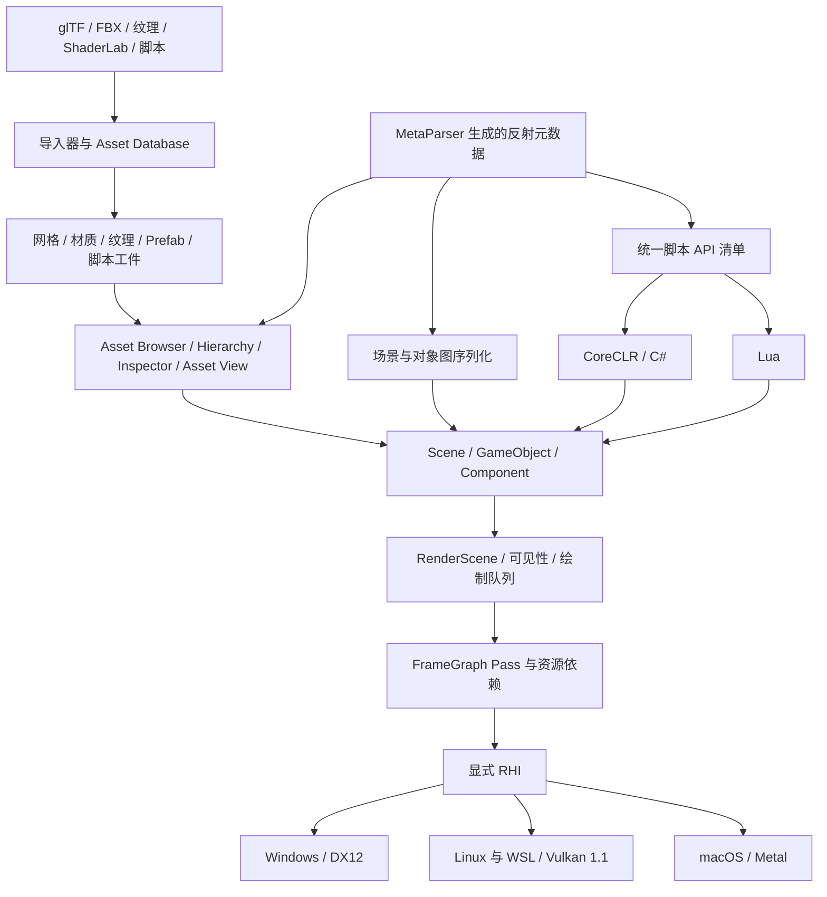

# 不只是在窗口里画一个三角形：Nullus 如何构建完整的实时 3D 创作链路

许多游戏引擎都从清屏色和第一个三角形开始。但真正困难的部分，往往发生在第一帧之后：模型如何变成可追踪的资产，材质如何跨图形后端保持一致，场景如何被编辑和保存，脚本如何在运行时找到同一个对象，以及一次改动如何在不重启整个工作区的情况下出现在画面里。

[Nullus](https://github.com/NullusEngine/Nullus) 想解决的正是这条完整链路。

Nullus 是一款持续演进的 C++20 原生 3D 引擎。它没有把 Editor、Game、资产工具和渲染后端做成彼此割裂的演示程序，而是让它们共享同一套场景、资源、反射和运行时语义。你在 Editor 中看到的场景，不是另一套“编辑器专用渲染”；进入 Play 后执行的脚本，也不是绕开原生对象模型的孤岛。

这篇文章不打算罗列所有功能。我们更想回答一个技术问题：**Nullus 如何把一次实时 3D 创作操作，从源文件一路送到屏幕？**


## 一条主链路，而不是几个拼在一起的 Demo

从用户视角看，一次典型操作可能只是：导入模型、拖进场景、修改材质、挂上脚本，然后点击 Play。向下展开后，它会经过一组职责明确的系统：



这里最重要的不是模块数量，而是数据只需要沿着一条可解释的路径流动。Editor 和 Game 共用运行时；C# 与 Lua 共用对象模型；不同图形 API 共用显式 RHI 契约；Inspector、序列化和脚本绑定则建立在同一份反射事实之上。

## 一帧画面如何走到 DX12 或 Vulkan

Nullus 当前的渲染主线围绕 `RenderScene`、FrameGraph 和显式 RHI 展开。

场景侧先完成同步、可见性收集、绘制命令准备和队列排序。兼容的 opaque mesh、material 与 render state 可以自动合并为实例化绘制；静态网格还可以使用构建后的 LOD 工件。随后，FrameGraph 声明每个 pass 对纹理和缓冲区的读写关系，编译依赖图、剔除无效 pass，再把准备好的工作交给 RHI 命令缓冲执行。

这意味着 GBuffer、deferred lighting、clustered lighting、decal、skybox、透明物体以及 Scene View / Game View 输出，不需要各自猜测资源此刻处于什么状态。资源依赖、barrier 和生命周期拥有统一的表达位置。

RHI 本身将 device、queue、swapchain、buffer、texture、binding set、pipeline、command buffer、fence 与 semaphore 建模为一等对象。后端专有 API 留在 DX12、Vulkan 或 Metal 的实现内部，上层渲染功能面向同一组契约编程。

资源绑定也有稳定的语义边界：

| Binding set | 主要职责 |
| --- | --- |
| `set0` | Frame / Scene 数据 |
| `set1` | Material 数据与纹理 |
| `set2` | Object 数据 |
| `set3` | Pass 或低频资源 |

着色器侧采用 **HLSL-first** 工作流。HLSL 是唯一维护的源，DXIL、SPIR-V 和反射信息由编译产物生成。这样做不是为了让所有后端看起来完全相同，而是为了消除“功能改一次、HLSL 和手写 GLSL 各维护一次”的长期漂移。运行时再根据编译反射建立 binding layout，让材质、Object 和 Pass 数据的约定与实际 shader 保持一致。

Nullus 也没有把“目录里存在后端代码”等同于“后端已经可交付”。Windows 的 DX12 与 Linux / WSL 的 Vulkan 1.1 是当前经过验证的显式 RHI 主线；DX11 与 OpenGL 仍处在迁移阶段，因此会被明确门控。像 HZB 遮挡剔除这样的能力，也先读取设备和格式能力，不满足条件时保持保守可见，而不是根据后端名称强行开启。

## 资产不是一个文件名，而是一组可追踪的工件

把一个模型拖进项目只是入口。Nullus 的资产管线需要继续回答：它生成了哪些 mesh、material 和 texture？颜色纹理与线性数据纹理如何区分？缩略图何时可用？Prefab 和场景又如何引用这些结果？

当前的 Asset Database 和导入工作流覆盖 glTF / FBX 模型、纹理、材质、ShaderLab、Prefab、场景以及 C# / Lua 脚本。模型导入可以生成网格、材质、纹理和子资源；静态网格支持 LOD 导入、简化与打包；纹理构建保留颜色空间语义，并接入 Mip 与压缩流程。

这些产物不仅服务运行时，也直接进入 Editor：

- Asset Browser 提供浏览、搜索、拖放、分类和对象引用选择；
- 模型、材质和纹理可以异步生成缩略图或预览；
- 在 Inspector 中选中材质即可编辑渲染状态、着色器与 uniform 参数，参数项由材质当前的 uniform 数据生成，Asset View 提供材质球预览；
- 场景对象可以创建 Prefab 与可编辑 Variant；
- 大型资源的加载、预热和 GPU 读回受异步队列、缓存与帧预算约束。

最后一点很关键。一个成熟的内容工具不能靠主线程同步等待所有资源。Nullus 把“预览尚未就绪”当作正常状态来设计，让资源工件、后台任务、GPU 提交和 Editor 呈现之间存在明确的所有权与完成边界。

## 反射是 Editor、序列化与脚本之间的连接层

如果 Inspector、场景序列化和脚本绑定各自维护一份类型信息，项目规模一大，三份事实一定会逐渐不同。

Nullus 使用 MetaParser 从 C++ 类型生成反射元数据。这份元数据继续驱动类型注册、Inspector 字段、对象图序列化，以及脚本 API 清单。换句话说，反射在这里不是一个只用来打印类型名的附属库，而是多个工具系统的共同输入。

场景中的 `Scene / GameObject / Component` 关系因此可以被 Editor 检查和修改，也可以通过对象图序列化持久化。脚本 API 生成器则从清单产生 C# / Lua 适配器，避免两种语言分别维护成员编号和原生调用约定。

这套做法带来的收益很直接：新增一个可公开的引擎能力时，审查点集中在原生实现、反射描述和 API 清单，而不是去三套系统里手工“补齐一个同名接口”。

## 一种对象模型，两种脚本语言

Nullus 当前同时提供 CoreCLR C# 与 Lua 后端。两者通过同一套原生脚本 ABI v2 访问 `GameObject`、`Transform`、`Component`、`Camera`、`Light`、`Time`、`Input` 与 `SceneManager`，并共享熟悉的组件生命周期：`Awake`、`OnEnable`、`Start`、`Update`、`OnDisable` 和 `OnDestroy`。

C# 脚本可以保持非常紧凑：

```csharp
using Nullus;

public sealed class Rotator : Behaviour
{
    private void Update()
    {
        transform.Rotate(Vector3.up * (90.0f * Time.deltaTime));
    }
}
```

Lua 使用相同的逐帧生命周期与时间语义：

```lua
local Rotator = {}

function Rotator:Awake()
    self.angle = 0.0
end

function Rotator:Update()
    self.angle = (self.angle + Nullus.Time.deltaTime * 90.0) % 360.0
end

return Rotator
```

在 Editor 中保存 C# 文件后，Asset Watcher 会排队执行增量构建。构建成功的程序集在安全帧边界切换，并尽力保留序列化字段；构建失败时，上一份有效程序集继续运行。项目还可以生成 Visual Studio / VS Code 调试配置，用断点检查正在运行的 Editor 中的脚本。

这里同样需要说明边界：当前脚本 API v1 尚未公开物理、音频、协程、Renderer / Material 与资源加载 API，也不提供 MonoBehaviour 兼容层。Nullus 选择把这些缺口明确写进文档，而不是用几个只有名称的空接口制造“已经支持”的印象。

## Editor 是架构的使用者，也是架构的压力测试

Nullus Editor 已经把 Launcher、Hierarchy、Scene View、Game View、Inspector、组件选择器、Gizmo、命中代理选取、播放控制、Asset Browser、Asset View、Console 与性能观测入口放进同一个工作区。

这些面板不是独立功能的集合。它们持续检验底层架构是否真的一致：

- Inspector 能否准确编辑反射字段；
- Asset Browser 能否在导入尚未完成时保持响应；
- Scene View 与 Game View 能否共享渲染资源语义；
- 点击 Play 后，场景、脚本与渲染是否仍沿用同一条主链路；
- 停止、重载或关闭 Editor 时，异步任务和 GPU 资源能否按所有权顺序退出。

因此，Editor 不只是 Nullus 的外壳。它是引擎各模块每天相互碰撞的地方，也是最容易暴露生命周期、缓存和线程边界问题的集成环境。

## 当前平台边界：把“可构建”和“已验证”分开

| 平台 / 后端 | 当前定位 |
| --- | --- |
| Windows / DX12 | 当前已验证的显式 RHI 运行时主线 |
| Linux、WSL / Vulkan 1.1 | 当前已验证的显式 RHI 主线；WSLg 是维护中的验证基线 |
| macOS / Metal | 工程包含原生后端与默认构建目标；Apple 运行时验证单独维护 |
| DX11、OpenGL | 仍在迁移，当前不是项目交付目标 |

仓库提供 Windows、Linux 和 macOS 构建脚本，GitHub Actions 分别为这三个平台配置了构建工作流，另有一个手动触发的 Metal 多线程验证工作流。单元测试覆盖反射、MetaParser、资产数据库、Prefab、渲染缓存和 RHI 等区域；性能测试与真实大资产基准则使用独立开关，避免把合成测试结果包装成真实场景性能结论。

这种区分可能不如一句“全平台支持”醒目，却更适合一个希望长期演进的引擎项目：功能是否存在、能否编译、是否跑过测试、是否在真实窗口中呈现，是四种不同等级的证据。

## Nullus 适合谁关注

Nullus 目前并不试图用功能数量替代成熟商业引擎。它更适合这些开发者：

- 想研究现代 C++ 引擎如何组织 Editor、Runtime、RHI 与资产系统的人；
- 在 DX12 / Vulkan、FrameGraph、资源状态与多线程渲染上寻找完整工程上下文的人；
- 希望理解反射如何同时服务 Inspector、序列化和脚本绑定的人；
- 偏好可查看、可修改的原生引擎，并愿意参与补全工具链与平台验证的人；
- 想在 C# 和 Lua 之间共享同一套游戏对象语义，而不是维护两套脚本世界的人。

你既可以把它当作实时 3D 创作工具来使用，也可以从某个具体模块开始阅读：一次材质重载、一张异步缩略图、一个实例化 draw，或者一次脚本程序集切换，都能沿着源码追到明确的责任边界。

## 用一次本地构建认识 Nullus

Windows 上可以从 DX12 Editor 开始：

```powershell
git clone https://github.com/NullusEngine/Nullus.git
cd Nullus
git submodule update --init --recursive
.\SetupDependencies.bat
cmake -S . -B build -G "Visual Studio 17 2022" -A x64
cmake --build build --config Debug --target Editor
```

Linux 可以使用仓库脚本构建 Vulkan 路径：

```bash
./SetupDependencies.sh
./build_linux.sh debug
```

完整的环境要求、后端说明和调试入口可以在以下位置找到：

- [GitHub 仓库](https://github.com/NullusEngine/Nullus)
- [中文 Wiki](https://github.com/NullusEngine/Nullus/wiki)
- [多后端 RHI 架构](https://github.com/NullusEngine/Nullus/blob/main/Docs/Rendering/RHIMultiBackendArchitecture.md)
- [C# / Lua 脚本 API](https://github.com/NullusEngine/Nullus/blob/main/Docs/Scripting/ScriptingApi.zh-CN.md)
- [贡献指南](https://github.com/NullusEngine/Nullus/blob/main/CONTRIBUTING.md)

Nullus 使用 Source-Available License。它允许查看和修改源码、商业使用，以及发布使用 Nullus 制作的游戏；同时对引擎源码再分发和制作竞争引擎设有限制。正式使用前，请阅读仓库中的 [LICENSE](https://github.com/NullusEngine/Nullus/blob/main/LICENSE) 原文。

## 结语

一个引擎的价值，不只在于它能画出什么，更在于开发者能否解释数据如何进入、状态如何变化、错误如何被定位，以及功能如何从 Editor 一直抵达真实运行时。

Nullus 仍在持续演进，但它已经形成了值得讨论的技术骨架：显式多后端 RHI、FrameGraph、统一 HLSL 管线、资产工件、生成式反射、双语言脚本和共享运行时。我们希望更多开发者来使用它、审视它，也沿着这些清晰的边界一起完善它。

如果你也关心一款现代原生 3D 引擎如何从第一帧走向完整创作链路，欢迎访问 [NullusEngine/Nullus](https://github.com/NullusEngine/Nullus)，运行 Editor，打开源码，然后从你最熟悉的那一层开始。
