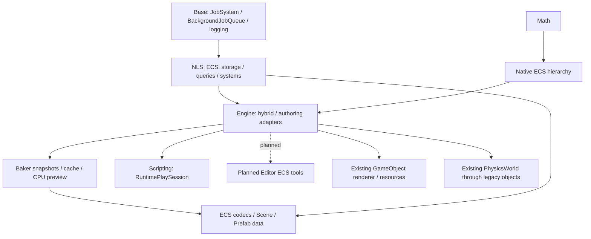

# Nullus ECS architecture and implementation plan

Status: implementation in progress. A checklist item is complete only after its
code builds and the relevant tests run. This document does not claim production
readiness or equivalence with Unity Entities or Unreal MassEntity.

## Repository audit (2026-10-29)

The working checkout contains extensive unrelated uncommitted work, including
RuntimePlaySession, input, audio, physics and editor changes. Preserve it. ECS
changes are additive and integration changes must retain the existing flow.

| Area | Current implementation and reuse | ECS boundary |
| --- | --- | --- |
| Objects | `Runtime/Base/Object/Object.h`: nonmovable `Object`, process `InstanceID` registry. `Runtime/Engine/GameObject.h`: owning component vector, mandatory Transform, scene ownership | An Entity is a value containing world/index/generation, never an Object or pointer. Do not reuse InstanceID as persistent entity identity |
| Components | `Engine/Components/Component.cpp`: idempotent Awake/Enable/Start/Disable/Destroy; reflection-based GameObject creation | Preserve every existing component; ECS components are independent C++ values |
| Scenes/Prefabs | `SceneSystem/SceneManager.h`: scene ownership, isolated Play sandbox, load/unload events; `Serialize/ObjectGraphDocument.h`: GUID/local object references and property values | Optional ECS scene ownership, independent versioned data; no mandatory conversion of old scenes |
| Transform | `Components/TransformComponent.h`: local/world TRS, parent links, matrices, revisions | Native ECS LocalTransform/Parent/WorldTransform now reuse Math; WorldPose runtime bridge keeps explicit authority |
| Play loop | `Scripting/RuntimePlaySession.cpp`: FixedStepClock, scaled/clipped time and step budget, legacy FixedUpdate then physics, Update then animation then LateUpdate; Pause/Step and Stop | Extend these existing safe points; no second simulation loop |
| Tasks | `Base/Jobs/JobSystem.h`: IJob/IJobParallelFor, dependencies and assisting completion; BackgroundJobQueue for file work. TaskGraph remains the graph/named-lane API | Reuse Jobs for ECS CPU work and background parsing without depending on underlying pool ownership; ECS retains conflict ordering and joins. Application owns service lifetime |
| Reflection | `Base/Reflection/Type.h`: process TypeID and generation, named types; `JsonConfig.h`: nlohmann JSON | Stable component names/IDs, explicit field codecs/version migration, optional reflection name. Process TypeID is not a persistence key |
| Rendering | `Components/MeshRenderer.h`: MeshFilter/material PPtr; `Rendering/SceneRenderStore.h`: render-owned proxies, immutable extraction inputs | Workers update CPU data only. Presentation adapters must use existing extraction/proxy lifetime rules |
| Physics | `Physics/PhysicsWorld.h`: generation-safe BodyHandle, box/sphere/capsule/mesh creation, Step, transforms, velocity, buffered contacts; Scene owns the world | Main-thread pre-step and post-step adapters, physics authoritative for dynamic poses; no new solver |
| Animation | `Components/AnimatorComponent.cpp`: existing AnimationInstance Evaluate/Finalize, immutable captured frames and resource programs | Reuse runtime and resources; synchronize before render extraction |
| Scripts | `Scripting/LuaScriptBackend.cpp`: VM and copied ScriptValue bindings; managed handle ABI in `Managed/Nullus.Managed` | Copy values across language boundary and revalidate handles every call. No retained chunk pointers; VM execution stays on main thread |
| Editor | `Project/Editor/Panels/Inspector.h`, Hierarchy, InspectorView and EditorUndoService | Edit persistent authoring data with existing Undo; runtime debugger re-resolves every entity |
| Infrastructure | Base provides logging, event dispatch, profiling and Jobs; Math provides vectors/quaternions/matrices. Allocator-symbol search and Base file survey found no engine-wide chunk allocator to reuse | Use standard aligned allocation and archetype-owned chunk reuse; ECS runtime never includes Editor or ImGui |
| Build/tests | runtime CMake helpers, optional shared libraries and platform exports; existing GoogleTest under Tests | Dedicated `NLS_ECS` runtime target and focused GoogleTest target; benchmarks separate from ordinary unit tests |

## Dependencies and ownership

A World owns its registry, archetypes, chunks, entity slots, resources and
systems. Its numeric identity never repeats during the process. Exhausted entity
generations retire their slots rather than wrapping. Component addresses are
borrowed only until a structural change; queries hold a structural freeze and
declare component/resource access. A World is controlled by its creating thread;
workers enter only through the scheduler/query APIs. Shutdown joins all accepted
jobs before releasing storage.

Chunks use aligned column storage with a configurable byte budget (16 KiB
default), inline entity handles, per-column change stamps and enable bits. Tags
have no column. Shared values are immutable chunk partition keys and change via
migration. Nontrivial components require noexcept move construction/destruction;
construct potentially throwing new values before moving any source value.
Swap-back repairs the moved entity's slot. Reuse empty chunks within each
archetype; explicit trimming controls retained memory.

Queries cache archetypes, not addresses. New archetypes extend the cache.
Read access stays const; only write access changes stamps. Changed filters are
conservative at chunk granularity. Change counters never wrap silently. Query
filters and parallel accesses use the same declared access sets.

Command buffers use per-writer streams and explicit ordering keys. Temporary
entities belong to one buffer generation. Playback occurs outside iteration;
commands are ordered by writer key and local sequence, with stale targets
diagnosed. Successfully applied commands are not silently replayed after errors.

System dependencies combine explicit before/after edges with component/resource
conflicts. Stable topological ordering orients otherwise unordered conflicts;
cycles fail before dispatch. Main-thread systems never execute on workers.
Independent systems use existing JobSystem jobs; chunk/hierarchy ranges use
IJobParallelFor. Joins surface exceptions/cancelled ranges and preserve captured
storage until completion. Completion can assist work on the waiting caller.
SceneStreaming parses self-contained Scene chunks on BackgroundJobQueue, then
commits only at owner-thread safe points. Failed replacements preserve old chunks;
superseded/cancelled requests cannot publish their data. Cross-chunk references
and per-entity time-budgeted commit remain future work.

## Phase plan and acceptance record

| Phase | Deliverable | State |
| --- | --- | --- |
| 0 | Repository audit, dependencies, ownership, implementation plan | Current integration-point audit and milestone design recorded |
| 1 | Safe Entity, registry, archetype/chunk storage, World, basic query, core tests | Headless Debug build and 22 tests passed |
| 2 | Advanced queries, shared/buffer/enableable, changes, ECB, systems/resources/multi-world | Headless Debug build and 37 cumulative tests passed; prefab commands follow serialization |
| 3 | JobSystem integration, dependency DAG, parallel chunk batches, safety tests | Migrated from initial TaskGraph implementation to native Jobs; current validation is recorded in Validation.md |
| 4 | GameObject/Transform bridge, PlaySession phases, scene cleanup, hybrid tests | Native 50/50 ECS and 13/13 Hybrid cases plus real Lua example passed; full editor/GPU acceptance remains open |
| 5 | Versioned scene/prefab codecs, references, full/incremental/live baking, resource build | Codecs/archives/Prefab/Transform, CPU Baking/Preview and asynchronous chunk loading implemented; Editor automatic Live hooks, cross-chunk references and AssetDB/Cook remain open |
| 6 | Render/physics/animation/particle adapters, AI and C#/Lua APIs | Pending |
| 7 | World/entity/archetype/system debugging and authoring/baking UI | Pending |
| 8 | Reproducible benchmarks, runnable samples, documentation, regression/sanitizer/platform validation | Five CPU examples, runtime/JSON archive benchmarks and 120 headless Debug/Release/ASan cases; full engine/editor/platform acceptance remains open |

Build and test results, exact commands, known limitations and remaining acceptance
items are maintained in `Validation.md`. Do not interpret a passing headless test
as live editor, GPU, managed runtime, or cross-platform acceptance.
