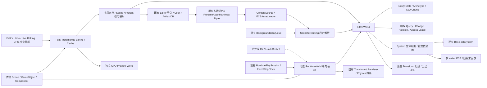

# Nullus ECS 阶段交付报告

**完整生产级 ECS 任务尚未完成。** 本次落地的是原生存储/运行时、并行调度与基础
混合运行接入，以及后续实现的原生 Transform、存档/Prefab、CPU Baking/Preview、
异步分块、原生资产/Cook/Npak 加载、Player ECS 启动，以及 Scene 持久身份与 Editor Live Baking。
可见 Player、子系统、脚本和编辑器的
完整验收保留在 [Remaining.md](Remaining.md)。
不能将这个里程碑视为 Unity Entities/MassEntity 的能力对等或全部 Phase 0–8 完成。

## 架构与模块

| 新增/修改 | 作用 |
| --- | --- |
| `Runtime/ECS/Core` | Entity、稳定 ComponentRegistry、拥有型值、Chunk/Archetype、World 与资源 |
| `Runtime/ECS/Query` | 类型化读写、可选参数、高级过滤、缓存、Chunk 借用、并行批次 |
| `Runtime/ECS/Commands` | 延迟创建、结构变更、独立 writer、Fork 排序域、回放诊断 |
| `Runtime/ECS/Systems` | 生命周期、阶段、资源/组件依赖、拓扑/环诊断、JobSystem 调度 |
| `Runtime/ECS/Jobs` | 借用期间的 Jobs 提交/join、ParallelFor 分片、异常与取消传播，不拥有线程池 |
| `Runtime/ECS/Serialization` | 字段 codec、格式/类型版本、局部引用、完整性、原子文件与 Prefab 覆盖/批量回滚 |
| `Runtime/Base/TaskGraph` | 早期实现新增的 SubmitTracked 与回归测试保留；ECS 调度已迁至 Jobs |
| `Runtime/ECS/Serialization/SceneStreaming` | 后台解析、owner 安全点提交、分块替换/取消/卸载、请求身份与生命周期 |
| `Runtime/Engine/ECS` | 显式关联、InstanceID 重新解析、单向 WorldPose、场景归属和清理 |
| `Runtime/Engine/ECS/TransformHierarchy` | 原生层级、dirty/revision、环/失效父清理、按层并行、派生矩阵重建 |
| `Runtime/Engine/ECS/Baking` | 真实 GameObject 输入快照、Baker/资源版本缓存、候选验证、失败保留与 Preview |
| `Project/Editor/ECS` / `Panels/ECSBakingPanel` | Scene 持久身份输入、Undo/事务安全点、Live 预览和原生资产导出 |
| `Runtime/Engine/ECS/ECSAssets` | 原生文档编译、资源版本快照、目录/Npak 读取与运行时默认解析 |
| Core Assets / Cook / Editor Assets | 新扩展名和原生类型、共享 Cook、依赖顺序与失效、Editor 导入/回滚 |
| `Runtime/Scripting/RuntimePlaySession.*` | 可选 ECS factory 与既有固定步、Pause/Step/Stop 对齐 |
| Runtime/Engine/Tests CMake | NLS_ECS、专用测试和示例目标，独立 headless 构建 |
| `Tests/ECS` | Core/Query/Command/System/并行/Hybrid 测试、基准和 ASan 配置 |
| `Samples/ECS` | Basics、MassSimulation、无窗口 Lua Hybrid、Baking 文件与运行时加载 |
| `Docs/ECS` | 架构、API、System/Job、Hybrid、Baking 边界、性能、验收和剩余任务 |

修改保留了原有未提交工作和 staging 边界，没有提交、reset 或批量改写旧组件。
RuntimePlaySession 在任务期间已有 FixedStepClock 等更新，ECS 按其当前路径增量接入。

## 实现与使用

Core 使用 World/Index/Generation 值句柄；耗尽的 slot 退役。布局以规范化组件集合
复用 Archetype，Chunk 内是 Entity 列和对齐组件列。迁移先完成可能失败的分配/共享
值准备，再进行 noexcept 移动，Swap-Back 修复 Location。Tag 无数据列；Buffer
拥有容器；Shared 是 Chunk 分组键；Enableable 不改变布局；Resource 独立声明依赖。

Query 缓存 Archetype，读取保持 const；写借用推进 Chunk 版本，Changed 是保守过滤。
结构变更在 Query/System 中被拒绝，通过 ECB 在阶段末提交。命令顺序由 writer key
和局部顺序定义，错误部分提交且可诊断。System 的显式拓扑先于隐式冲突定向，独立
系统和 Chunk 批次使用真实 JobSystem；退出前 join，主线程系统保留线程约束。

简单 API、可运行源码和命令分别见 [README](README.md)、
[Systems-Jobs](Systems-Jobs.md) 和 `Samples/ECS/`。面向游戏的主要入口为
RegisterComponent、CreateEntity、Add/Remove/Set/Read/WriteComponent、Query、
SetResource 和 Systems；ChunkView 提供引擎内部的批量列访问。

## 兼容与集成范围

已有项目默认不创建 ECS Entity 或 World。EnableECS 显式启用，旧 Scene/Prefab
格式不变。桥接可选 None/GameObject/Entity authority，每个数据方向唯一；动态
3D/2D 刚体保持物理权威。传统对象销毁的通知先标记，安全点再清理 ECS；Entity
销毁默认解除链接，只有明确拥有的表现对象才随它删除。

当前 Renderer/Physics 复用以传统表现对象和既有 Scene 路径为边界；没有实现原生
ECS render proxy/actor 描述与提取。Animation/Particle 专用适配、C#/Lua ECS API
尚未实现。真实传统 Lua 与 ECS 的共存验证不等于已经有 Lua ECS API。

ECS Scene/Prefab 字段存档、引用重映射/覆盖/批量回滚、ECB InstantiatePrefab、
Full/Incremental Baker、内存缓存和独立 CPU Preview 已实现。资源/对象/组件删除
和失效、Baker 版本变更、失败保留旧产物均有测试。当前 ObjectId 必须显式提供，
尚无自动 Editor 持久身份映射、Live 事件/Undo、磁盘缓存或 Editor ECS 面板。
AssetDB/Cook 注册和内容包加载现已实现，详细边界见
[Asset-Pipeline](Asset-Pipeline.md)、[Authoring-Baking](Authoring-Baking.md) 和 [Hybrid](Hybrid.md)。

## 验证、测量与后续

实际编译、自动测试、ASan、基准原始 CSV、示例输出和 Native 构建条件全部记录在
[Validation.md](Validation.md)。内存数字是已知 World storage 统计，不等同于进程
峰值。测试和示例的 CPU 验证不代表 GPU、完整 Editor 可见交互或跨平台验收。

- 独立 Debug、Release、Windows ASan 各 **75/75** 通过（50 ECS + 25 既有 TaskGraph）。
- 原生共享 DLL **50/50 ECS、13/13 Hybrid** 通过；其中 50 项是上述 ECS 用例的重复
  原生验证。另有 9 项并行/关闭用例连续通过 10 轮。
- Basics、100,000 Entity 的 MassSimulation、真实 Lua Hybrid 均已运行并校验输出。
- 默认 16 KiB、1,000,000 Entity：创建 **100.7511 ms**；Position 三维移动的串行/
  并行每次平均 **13.070434/3.962325 ms**，各计时 32 次。测量条件、其他操作和
  [三种 Chunk 预算的原始数据](Performance.md) 已保留，不能当作完整游戏帧率保证。

此前 Phase 5 的验证扩展为：Debug、Release、ASan 各 **101/101** 独立用例；
原生 DLL **66/66 Core、10/10 Transform、8/8 Baking、13/13 Hybrid** 通过。原生
Core/Transform 是独立用例的重复 DLL 验证，不累计为额外唯一用例。Baking 示例
实际输出 `full_rebuilt=2 incremental_rebuilt=1 incremental_reused=1`，销毁 Authoring
后从文件加载 `loaded_entities=2 child_world_x=13`。历史 75 项结果保留为阶段记录。

此前 Jobs/异步分块里程碑在 Debug、Release、ASan 各通过 **120/120** 独立用例。
ECS CPU 工作已改用 Base JobSystem，文件解析使用 BackgroundJobQueue；自包含分块的
替换、取消、卸载和帧内提交已接入 RuntimeWorld。原生 DLL 已通过 **85 Core、10 Transform、
15 Hybrid、8 Baking** 项；构建条件见 Validation.md。分块示例实际输出
`loaded_chunks=2 entities=4 background=1`，卸载一个后
`unloaded=2 remaining=2`。新的四规模 Core 基准共 40 条成功记录，见
[JobSystemBenchmarkResults-16k.csv](JobSystemBenchmarkResults-16k.csv)；此前 TaskGraph
测量作为历史数据保留，不能混作同一轮测量。

当前原生资产链路已接通：`.ecsscene` / `.ecsprefab` 经既有 Editor 导入、ArtifactDB、
Cook、依赖闭包和 Npak，进入 RuntimeWorld 的后台分块加载与 Prefab 实例化。
默认资源适配检查 GUID、目标内容版本与可用性；不替代既有纹理/模型 loader。
完整使用方式见 [Asset-Pipeline](Asset-Pipeline.md)。最新独立 Debug/Release/ASan
各 **122/122** 通过；原生 DLL **136/136** 通过，含 **13 资产、3 Editor 导入** 项。
原生 Core/Transform 的重复验证不计为新用例，合计 **161** 个不同测试。
打包示例在删除开发缓存后输出 `scene_entities=2 total_entities=6 child_world_x=13`，
并确认后台解析。托管全构建的文件占用、原生隔离重编条件与精确证据见 Validation.md；
没有据此宣称完整仓库、可见 Editor 或 GPU 验收通过。

后续 Player 启动扩展已完成原生构建根、GUID/子资产配置、内置 Transform、C++ 游戏
注册回调和首次加载失败回滚。11 项启动测试和上述 136 项原生回归均通过，合计
**147/147**，对应 **172** 个不同用例。实际 Game.exe 已编译，包自检在删除开发
Assets/Library 后成功，错误身份返回失败码 8。DLL 依赖从隔离验证目录解析；这不是
完整可分发 Player 或 GPU 验收。配置与代码示例见 [Player-Startup](Player-Startup.md)。

新增存档基准已覆盖百万实体，36 条测量全部成功。实测也暴露并修复了 JSON 回调
解析器在父数组上重复扫描的问题：当前使用 SAX 校验加普通 DOM，保留重复键/深度
限制。百万实体 JSON 为 432,889,161 字节，解析 **16.81 s**，创建运行时实体
**4.01 s**，500,000 个双实体 Prefab 批量生成 **3.08 s**。这仍有明显的文本/对象
分配开销，需要后续 Cook/分块优化，详细原始数据见 Performance.md。

组件要求默认构造、noexcept 移动/析构；写引用和 span 不能跨结构变更或写游标边界
保存。运行期类型卸载/热重载要先结束相关 World，不能让操作函数指向已卸载模块。
目前调度采用依赖前沿 barrier、查询 Entity 过滤采用值列表、Shared 分组复用采用
值比较，后续仍有明确的批量、索引、内存分配与流水化优化空间。

下一步补齐 Editor 持久身份，再做原生子系统、脚本、Editor Live
工作流，最后运行全部项目回归、GPU/平台测试。验收项逐条跟踪，尚未完成的
能力没有用空类、虚构 benchmark 或成功占位代替。
