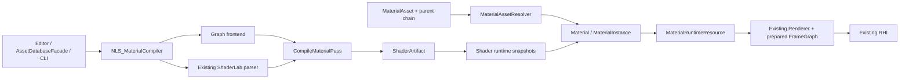

# Material editor implementation

Approved architecture, revised 2026-10-17. Changes follow the existing resource,
ShaderArtifact, Material and RHI paths. This file records implementation gates;
a declaration or an editor control alone does not complete a gate.

## Runtime boundary

ShaderLab/HLSL and ShaderGraph produce the same pass ShaderArtifact. Logical
MaterialParameterSchema records identity, type and defaults. Physical reflection
belongs to a target and keyword variant; stages of different variants are never
merged. Renderer consumes Material and immutable GPU binding snapshots, without
checking the authoring frontend.

MaterialAsset stores a shader reference or a parent material reference, local
overrides, explicit static true/false assignments and sampler/render state
overrides. MaterialAssetResolver detects cycles and resolves defaults, root,
ancestors and local values in that order. Transient MaterialInstance overrides
are applied last and never saved into a persistent asset. Existing
PPtr<Material> identities remain the scene-facing interface.

The new compiler target NLS_MaterialCompiler depends on NLS_Render. Editor and
tools consume the compiler. NLS_Render does not depend on the editor or compiler
target. The existing ShaderCompiler implementation remains in NLS_Render.

## Implemented class boundaries

| Type/module | Responsibility |
| --- | --- |
| `Rendering/Assets/MaterialAsset` | Sparse durable shader-or-parent reference, values, static true/false, render states and complete sampler descriptors |
| `MaterialAssetResolver` | Walk and validate the inheritance chain, apply defaults/root/ancestors/child, map stable parameter IDs and retain orphan values |
| `Resources/MaterialInstance` | Independent transient values, clear overrides and recursively rebase dynamic descendants |
| `ShaderArtifact` | Per-pass executable stages and per-target/keyword reflection, schema, neutral rendering interface and dependency snapshot ID |
| `MaterialParameterSchema` | Stable logical identity, type, default, editor annotations; no physical cbuffer offsets |
| `ShaderBindingLayout` | Concrete target/keyword reflection and shader generation used for binding; physical cbuffer offsets/registers belong here |
| `MaterialRuntimeResource` | Immutable schema/layout and shared RHI binding/pipeline ownership retained by prepared/recorded draws until retirement |
| `MaterialDependencySnapshot` | Frozen source/artifact bytes, metadata hashes, include/function edges, build context and Applied generations; archives validate content hashes |
| `MaterialDocument` / `MaterialSourceDocument` | Existing Undo-backed Working/Saved history, external-save conflict detection; MaterialDocument separately records Applied |
| `MaterialEditingService` | Shared Inspector/workbench sessions, frozen dependency selection, async compile, private preview and frame-boundary scene publication |
| `MaterialGraphView` / `MaterialEditor` | Node/code/parameter authoring, diagnostics, inheritance controls, preview, explicit save/apply/resource publication |
| `MaterialCooker` / `NullusMaterialCompile` | Collect actual variants plus explicit collection, compile shared passes, flatten materials, copy frozen texture artifacts, publish standard ArtifactDB |

`NLS_MaterialCompiler` depends on `NLS_Render`, which already owns ShaderCompiler
and depends on the existing Core asset/RHI interfaces. Editor and the CLI depend
on the compiler. Engine and Renderer do not link the graph compiler or editor.

## GPU binding contract

DXIL and SPIR-V are reflected independently for each Pass/Variant. Cbuffer
capture zero-initializes the reflected byte size and writes supported scalar,
vector and matrix values at reflected offsets. Unsupported cbuffer arrays are
diagnosed instead of assuming C++ array packing. SPIR-V reflection reverses the
repository's existing DXC binding shifts. Existing set order is Frame
space0/set0, Material space2/set1, Object space3/set2, Pass space1/set3.

Texture and Sampler bindings use existing RHI binding layout/set objects and
descriptor allocation. Numeric changes create updated material binding snapshots;
recorded draws retain earlier sets and their resources. Shader reload and keyword
changes select new generation/variant keys. Engine Object ABI changes between
keyword variants are rejected because the current engine provider owns that ABI.
Material-space offsets/registers may differ between variants.

Native Cube parameters retain a shared TextureCube wrapper in the Material copy
and upload face/mip subresources through existing device texture creation. Vulkan
initial uploads map subresource indices to both array layer and mip level.
Built-in texture defaults are material-owned resources and participate in the
existing scene texture-readiness path without requesting an external image.

Publication drains the existing threaded rendering boundary before changing the
stable Material facade. Captured RHI resources retain shared ownership through
recorded command owners and existing frame retirement. This first implementation
uses the existing conservative drain; it does not introduce a second GPU fence or
descriptor lifecycle system.

## Editing and publication

Working, Saved and Applied are separate. Save persists the current document;
Apply publishes a complete dependency snapshot; Save and Apply is explicit.
Discarding Working does not change Applied. File watching and import cannot
silently publish saved authoring edits.

A dependency snapshot freezes sources, parent materials, includes, functions,
metadata, target, variants, toolchain and Applied dependency generations.
Compile results and publications compare the complete snapshot, not only the
active document revision. Dependencies use Applied content unless their Working
content is explicitly selected for the publication bundle.

## Rendering requirements

Retain the current three RGBA8 GBuffer attachments. Albedo/normal alpha contain
the geometry normal; material RGB contain metallic, roughness and AO. Existing
channel reuse cannot hold arbitrary HDR emission.

| Option | Consequence in the current code |
| --- | --- |
| Reuse GBuffer channels | RGB already stores base color, shading normal and metallic/roughness/AO; albedo/normal alpha store geometric octahedral normal components and material alpha stores receives-shadows. Flags alone cannot store arbitrary HDR emission. |
| Add RGBA16F | Adds eight bytes per pixel plus attachment bandwidth and requires coordinated GBuffer/lighting/RHI changes. It is not the default prerequisite for authoring materials. |
| Independent Unlit/ForwardOpaque | Keeps the three existing RGBA8 targets; affected meshes pay for depth and forward color draws. Shared depth/stencil preserves opaque occlusion and excludes those pixels from deferred lighting/decal. This is the implemented first path, also used for PBR with emission. |

The approved default is hybrid rendering: deferred PBR, plus shared-depth
ForwardOpaque for Unlit and emission-enabled materials. A depth/stencil stage
must precede HZB and deferred lighting; full forward color precedes transparency.
ForwardOpaqueDepth and ForwardOpaqueColor are typed RenderPassCommandKind
values, inserted into the existing prepared deferred FrameGraph sequence.

WPO runs in Vertex, clamps to a declared maximum world displacement and expands
object/submesh/spatial/HZB bounds. Color, Depth, Picking, SelectionMask and
ShadowCaster share the vertex evaluation and frame/material snapshot. Missing
bounds prevent enabling WPO; ordinary geometry culling remains enabled.

## Gates and evidence

| Gate | Acceptance |
| --- | --- |
| P0 | Handwritten ShaderLab to ShaderArtifact, MaterialAsset, GPU bindings and real DX12/Vulkan pixel readback |
| P1 | Persistent parent references, inheritance/cycles, defaults, explicit false, isolated dynamic instances and rebase |
| P2 | Transactional material creation, parameter editor, independent versions and dependency-snapshot publication |
| P3 | Hybrid rendering, WPO, auxiliary passes and ParticleSprite ABI integration |
| P4 | Graph/functions/Custom HLSL compiled through the same material compiler |
| P5 | Complete workbench, declared variant cooking, source-free runtime and platform verification |

The Windows checkpoint below supersedes the early P0 test counts. Implementation
and platform/interactive acceptance are recorded separately.

macOS/Metal require separate build and device evidence. GLSL conversion does
not establish an enabled OpenGL backend. Dynamic shadow rendering is a separate
dependency; the material ShadowCaster contract does not establish a working
shadow-map renderer.

## Revised implementation sequence

1. P0: Reuse the handwritten ShaderLab parser and ShaderCompiler; write/load
   ShaderArtifact v2 with v1 compatibility, exact physical reflection, MaterialAsset
   projection and retained GPU bindings. Verify actual DX12/Vulkan pixels first.
2. P1: Add sparse native `.mat` inheritance and transient runtime instances;
   validate missing parents/cycles, explicit static false, schema rename/orphans,
   persistent and dynamic update propagation.
3. P2: Share the document/editing service with Inspector, create native resources
   through existing Undo transactions, separate save/preview/apply, freeze and
   archive dependency bytes and publish at the existing frame boundary.
4. P3: Retain GBuffer layout. Add typed shared-depth ForwardOpaque passes, stencil
   exclusion, required RHI fixes and conservative WPO bounds; consume generated
   Picking/SelectionMask in existing editor passes and validate the particle ABI.
5. P4: Add Graph/function/CustomHLSL frontend, stable identities and node/code
   workbench on the same backend. Validate generated Passes for both bytecode
   targets and ensure source edits update separate live material roots together.
6. P5: Cook only actual resolved static assignments plus explicit collections;
   reuse ArtifactWriter/ArtifactDB, copy frozen texture content and verify runtime
   loading after deleting creation sources. CLI and UI share this cook path.
   Gate platform/device/interactive acceptance separately from source completion.

See `MaterialEditorUsage.md` for editor entry points, publication paths and CLI.

## Windows validation checkpoint

- Debug Editor, compiler CLI, Render/Engine/Editor libraries and material targets
  build with the repository's clean-environment wrapper.
- `build/material-verified-runtime.xml`: 22/22, including DX12 and Vulkan pixel
  readback with different material registers/offsets, retained snapshot lifetime,
  shared-depth/stencil exclusion and forward color; the cook test removes source
  and build-cache folders before runtime loading, including a frozen texture.
  The material GPU test also loads a native Cube parameter with two mip levels,
  copies/destroys CPU material wrappers and samples the first/last cube faces.
  Clearing a dynamic texture override restores the base resource ownership and
  path as well as the parameter value.
- `build/material-verified-editor.xml`: 7/7, covering native creation/Undo identity,
  inherited static false import, parent/dynamic propagation, shared-program
  application across distinct roots, independent versions/resource publication,
  hybrid FrameGraph ordering and WPO spatial/frustum/HZB bounds.
- `build/material-final-imports.xml`: 16/16, with executable DXC enabled explicitly;
  v2 payload and isolated variant reflection expectations replace the old shared
  reflection assertions.
  SPIR-V resource names are canonicalized from DXC's `type.` block names so that
  ParticleSprite and engine ABI validation use the same logical names as DXIL.
- `build/material-verified-bindings.xml`: 312/312 existing material conversion,
  frame/object binding, shader generation, particle scene and particle sprite
  tests. This includes actual DX12/Vulkan user-material particle draws in forward
  and deferred scenes.
- `build/material-verified-regressions.xml`: 823/823 after the Cube/default texture
  changes, covering the existing shader importer, material conversion, deferred
  FrameGraph, scene visibility/cache/occlusion, frame/object bindings, picking,
  selection, serialization, texture lifecycle and particle suites. No tests in
  this final run were skipped.
- `build/material-cli-smoke.log`: CLI generated a `win64` ArtifactDB and immutable
  shader/material artifacts for `build/MaterialExample`.
- `build/material-editor-startup.log`: rebuilt Editor showed its window and
  exported 15 validation frames. Node mouse/keyboard workflows and target-device
  coverage remain separate interactive acceptance gates.
  The first scratch scene triggered the existing unsaved-scene prompt at shutdown;
  the validation process was stopped after its trace completed. This is startup
  evidence, not a clean-shutdown claim.
  A second run using the existing readback validation mode exited normally and
  wrote `build/material-clean-summary.json` with `readbackStatus=success` and
  1,751,241 nonblack Scene View pixels.
