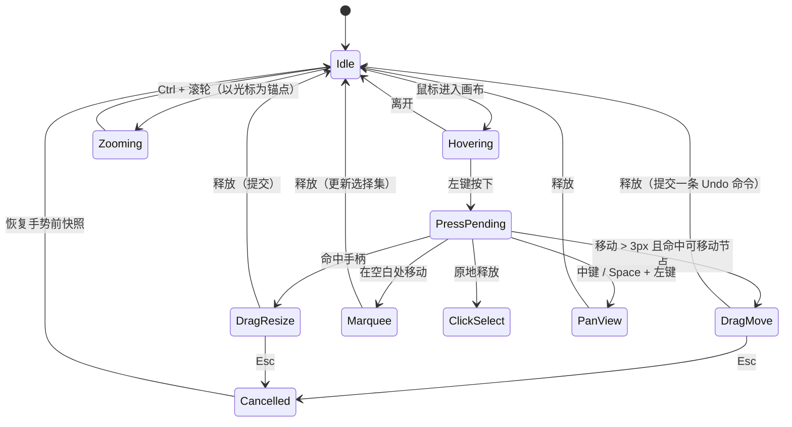
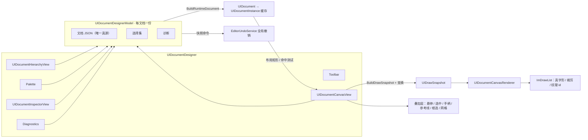
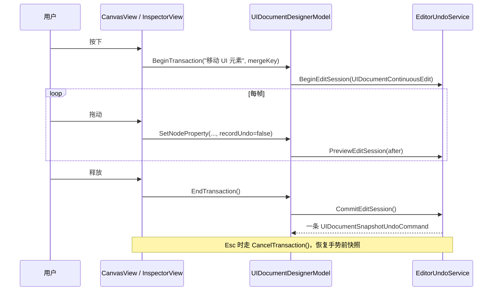
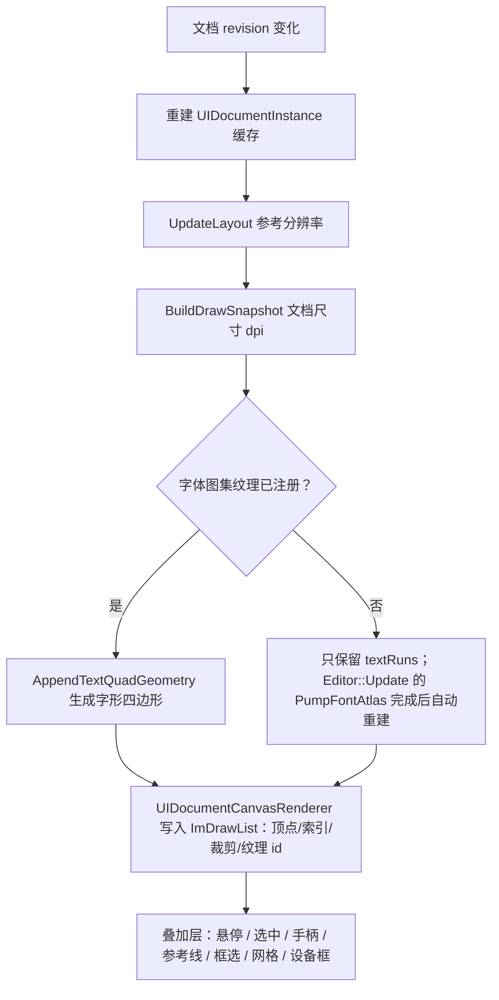

# UI Designer 重建

状态：P0 已实现（2026-10-19），P1-P4 待实施。目标是在不改变 `.ui` schema 与运行时语义的前提下，
把 `Project/Editor/Panels/UIDocumentDesigner.*` 从"只读预览 + 少量 JSON 字段编辑"升级为可
直接摆放、对齐、批量编辑的可视化编辑器。

P0 落地内容：

- 新增 `UIDocumentCanvasView` / `UIDocumentCanvasRenderer` / `UIDocumentInspectorView` / `UIDocumentHierarchyView`，
  面板改为工具栏 + 层级/调色板 + 画布 + Inspector + Problems 五区布局，左右分隔条可拖动。
- 画布：`UIDocumentInstance` 缓存、`UIDrawSnapshot` → `ImDrawList`（真字形/裁剪/纹理 id）、缩放平移、
  8 手柄缩放、拖动移动、网格与边/中心吸附参考线、框选多选、右键菜单、调色板拖放建节点。
- 模型：通用路径属性 API、复制/移动/层级序/显隐/粘贴、多选选择集、`CancelTransaction`、
  诊断 JSON 路径 → 节点映射；所有结构操作复用快照撤销。
- Inspector：布局/锚点/样式/内容/动作全字段（P0 范围），标准字段由编辑器侧反射 ViewModel
  （`UIDocumentNodeEdit`）交给共享的 `ReflectedPropertyEditor` 绘制，并通过共享的 `IReflectedEditHost`
  事务桥接写回；JSON 仍是真源。3×3 锚点预设与运行时 rect 派生的 Position 保留自定义行。
  详见 `ReflectedInspectorHost.md`。
- 层级：搜索、内联重命名、拖拽排序/换父（自身子树拒绝）、右键菜单、显隐开关、与画布双向选择。
- 生命周期：未保存守卫（Save/Discard/Cancel）、外部修改横幅（Reload/Keep Local）、error 阻止保存、
  warning 不阻止、Problems 点击定位；`OwnsShortcuts()` 让全局快捷键在面板聚焦时让位，并自行处理
  `Ctrl+Z/Y/S/D/C/V`、`Del`、`F2`、`F`、方向键与缩放。

- 实现相关：`Project/Editor/Panels/UIDocumentDesigner.{h,cpp}`、`Project/Editor/UI/UIDocumentDesignerModel.{h,cpp}`
- 运行时相关：`Runtime/Engine/UI/UIDocument.*`、`UIElement.*`、`Rendering/UI/UIDrawSnapshot.h`、`Rendering/UI/UIFontTextShaper.*`、`Runtime/UI/UIManager.cpp`
- 参照实现：`Project/Editor/Panels/VfxEditor.cpp`（多文档 + 工作区 + 快捷键让位）、`Project/Editor/Materials/MaterialDocument.h`（Working/Saved 分离、外部修改冲突）
- 设计图：`UIDesignerMockup.svg`（面板布局、锚点预设、层级拖拽、手柄与吸附细节）

## 1. 现状与问题（证据）

| 环节 | 现状 | 影响 |
| --- | --- | --- |
| 摆放元素 | `UIDocumentDesignerModel` 只暴露 `SetNodeLayoutSize/Mode/Spacing`，没有 anchor/pivot/offset 编辑；画布只能点选 | **无法摆放元素**，这是"基本不可用"的首要原因 |
| 画布 | 固定 fit 缩放，无缩放/平移/网格/标尺/参考线；每帧 `BuildRuntimeDocument` + `Instantiate` + `UpdateLayout`（`UIDocumentDesigner.cpp:280-306`） | 大文档卡顿；无法精确定位 |
| 预览保真 | 只用 `ImDrawList` 画背景矩形 + ImGui 默认字体文本，所有节点都描边，无裁剪、无纹理（`UIDocumentDesigner.cpp:472-514`） | 与运行时差异大，误判结果 |
| 属性面板 | 仅 name/text/layout.mode/size/spacing/backgroundColor（`UIDocumentDesigner.cpp:326-423`） | schema 大多数字段（锚点、偏移、填充、透明度、可见性、字体…）只能手改 JSON |
| 撤销粒度 | Drag 控件在 `IsItemActivated` 后 `BeginTransaction`，Pop‑up 类控件（Combo/Color）激活帧与变化帧不一致 | Combo/颜色弹窗等改动可能落回快照（`UIDocumentDesignerModel.cpp:1100-1106` 的空事务即回滚路径） |
| 层级 | 无右键菜单、重命名、拖拽排序/换父、显隐 | 结构调整只能靠删了重建 |
| 多文档 | `OpenDocument` 直接覆盖当前模型（`UIDocumentDesigner.cpp:109-121`），无未保存提示、无外部修改检测 | 有数据丢失风险 |
| 诊断 | 路径不可点击；只要有任意诊断（含 warning）就不能保存（`canSave = IsDirty && diagnostics.empty()`） | 报错无法定位，warning 误伤保存 |
| 快捷键 | 无 | 与其它编辑器体验差距大 |

运行时已具备、设计器尚未利用的能力：锚点/枢轴/偏移/最小最大尺寸/边距/内边距/宽高比/
`flexGrow`/`gridColumns`/`clipChildren`/`direction`/`align`（`UICommon.h:105-128`），
`style.color/opacity/visible/enabled/interactive`（`UICommon.h:130-142`），`className`，
`fontAssetId/fontPixelSize`，以及 `UIDrawSnapshot` 的批次/裁剪矩形/纹理 id 与字形四边形
（`UIDrawSnapshot.h:37-93`、`UIFontTextShaper.cpp:87-175`）。设计器将这些能力全部释放出来，
不做运行时 schema 改动。

## 2. 目标与非目标

P0 完成后的验收目标：

1. 用鼠标在画布上摆放、缩放、对齐元素，所见即运行时布局（同一套 `UIElement::Measure/Arrange`）。
2. 上一节列出的布局/样式/内容字段全部可视化编辑，且每个手势只产生一条撤销命令。
3. 层级树支持增删改、重命名、拖拽排序/换父、显隐切换。
4. 文档生命周期安全：未保存提示、磁盘外部修改检测、错误/警告区分、诊断可点击定位。
5. 预览使用运行时字形与裁剪；纹理/资源选择留给 P2。

非目标（明确不做）：

- 不新增 `.ui` schema（旋转、九宫格边框、圆角等运行时字段缺失的能力不在 P0 范围）。
- 不改动运行时布局与渲染语义；设计器只消费 `UIDocument`/`UIDrawSnapshot`。
- P0 不做多文档标签、交互预览、样式表/绑定/动画编辑（P1-P4）。

## 3. 设计图

### 3.1 面板布局（线框图）

```
┌ UI Designer ───────────────────────────────────────────────────────────────────────────────┬─ □ ✕ ┐
│ [HUD.ui ●] [Options.ui] [+]                                        （P1：多文档标签）      │      │
├────────────────────────────────────────────────────────────────────────────────────────────┴──────┤
│ Save Revert │ ↶ ↷ │ [Fit] 100% [−][+] │ 1920×1080 ▾ │ [Grid] Snap 8px ▾ │ [Wireframe] │ [PX]   │
├───────────────┬───────────────────────────────────────────────────────────────────┬────────────────┤
│ Hierarchy  🔍 │ ┌───────────────────────────────────────────────────────────────┐ │ Inspector      │
│ ▾ HUD         │ │ 标尺 ┊        ┈┈┈┈ 吸附参考线 ┈┈┈┈                           │ │ ▾ Element      │
│   ▾ HUD       │ │ ┌───────────── 1920×1080 设备框 ─────────────────────────────┐ │ │  Type Panel    │
│     ▸ Health… │ │ │      AmmoLabel “12 / 30”  ← hover 描边                      │ │  Name  […    ] │
│     ▸ Crossh… │ │ │   ┌───────────────────────┐        ┌──────────────┐          │ │  Class […    ] │
│               │ │ │   │ HealthPanel  ← 选中   │        │ ReloadButton │          │ │  GUID  a1b2…⧉  │
│ 显隐 👁 / 内联  │ │ │   │  ┌──────────┐         │        │   RELOAD     │          │ │ ▾ Rect&Anchor  │
│ 重命名 / 拖拽  │ │ │   │  │ BarFill  │         │        └──────────────┘          │ │  ┌───┬───┬───┐ │
│               │ │ │   │  └──────────┘         │   ┌─────────┐                    │ │  ├───┼───┼───┤ │
│ 右键菜单：     │ │ │   └───────────────────────┘   │ Minimap │ (Image 纹理)       │ │  └───┴───┴───┘ │
│ 新建/复制/删   │ │ │                               └─────────┘                    │ │  Pos X Y Size  │
│ 序/显隐        │ │ └──────────────────────────────────────────────────────────────┘ │  Pivot/Offset  │
│               │ │  x120 y340 · 45% · draw calls 12            [−] 45% [+] [Fit]   │ │ ▾ Layout       │
│ Palette   🔍  │ └───────────────────────────────────────────────────────────────┘ │ ▾ Style        │
│ [Panel][Image]│                                                                   │ ▾ Content      │
│ [Text][Button]│  ✖0 ⚠1  $.root.children[0].children[1] 文本为空（warning，点击定位） │ ▾ Actions      │
│ [Toggle]… …   │                                                                   │                │
└───────────────┴───────────────────────────────────────────────────────────────────┴────────────────┘
```

三块内容区各自独立滚动；左列上下两段（Hierarchy / Palette）可拖动分隔；右侧 Inspector 分节折叠，
状态保存在 imgui.ini（面板已有能力）。细节（锚点预设、层级拖拽指示、手柄与吸附参考线）见
`UIDesignerMockup.svg`。

### 3.2 画布交互状态机



### 3.3 组件与数据流



### 3.4 编辑事务（一次拖动 = 一条历史）



### 3.5 预览渲染（WYSIWYG）



## 4. 详细设计

### 4.1 文档会话与生命周期（P0 单文档安全，P1 多标签）

- `UIDocumentDesignerModel` 保持"JSON 即真源"与快照撤销（现有测试大量依赖其行为），扩展以下能力，
  不改 `Load/Save/Reload/IsDirty/GetUndoScope` 语义。
- 新增**未保存守卫**：`RequestCloseDocument/RequestOpenPath` 返回枚举（已保存 / 需要确认 / 取消），
  面板弹 `Save / Discard / Cancel` 三选一；`Reload` 与关闭面板标签走同一入口。
- 新增**外部修改检测**：加载/保存时记录文件哈希与写入时间；面板每 ~0.5s 比对一次。
  - 未修改 → 顶部提示条 `文件已在磁盘上变化：Reload / 保留当前`；
  - 已修改 → 冲突提示条，禁止静默覆盖（与 `MaterialDocument` 的 Working/Saved 分离一致）。
- 新增 `SaveAs(path)`：写新路径 + 迁移撤销作用域（旧作用域 `InvalidateScope(Reloaded)`）。
- P1 多标签：面板持有 `std::vector<std::unique_ptr<UIDocumentDesignerModel>>` + 活动索引 + 每文档视图状态
  （缩放/平移/设备/网格），复用 `VfxEditor` 的标签与快捷键让位模式（`OwnsShortcuts()`）。

### 4.2 模型 API 扩展

保留现有 setter（测试兼容），新增：

```cpp
// 通用属性写入：路径点分（"layout.anchorMin"、"style.opacity"…），带类型校验与撤销合并键
bool SetNodeProperty(std::string_view nodeGuid, std::string_view path, const Json& value,
                     bool recordUndo = true, std::string label = {}, std::string mergeKey = {},
                     bool allowMerge = false);
// 便捷包装（内部走同一实现）
bool SetNodeVector2(nodeGuid, path, UIVector2, ...);   // anchorMin/Max、pivot、offset*、size、min/max、margin、padding
bool SetNodeFloat(nodeGuid, path, float, ...);         // opacity、aspectRatio、spacing、flexGrow
bool SetNodeUInt(nodeGuid, path, uint32_t, ...);       // gridColumns
bool SetNodeBool(nodeGuid, path, bool, ...);           // clipChildren、visible、enabled、interactive、password
bool SetNodeColor(nodeGuid, path, UIColor, ...);       // style.backgroundColor、style.color
bool SetNodeString(nodeGuid, path, std::string, ...);  // name、className、text、layout.mode/direction/align
bool SetNodeFont(nodeGuid, fontAssetId, pixelSize, ...);

// 结构操作（均走撤销）
bool DuplicateNode(nodeGuid, bool selectCopy = true);
bool MoveNode(nodeGuid, parentNodeGuid, size_t index);   // 拒绝移入自身子树
bool NudgeNode(nodeGuid, UIVector2 delta, bool snapToGrid, float grid);  // 画布方向键
bool BringForward(nodeGuid); bool SendBackward(nodeGuid);
bool BringToFront(nodeGuid); bool SendToBack(nodeGuid);
bool SetNodeVisible(nodeGuid, bool visible);

// 选择
void SelectNode(nodeGuid, bool additive = false);        // additive=false 时替换选择（保持旧语义）
void SetSelection(std::vector<std::string> nodeGuids);
[[nodiscard]] const std::vector<std::string>& GetSelectedNodes() const;
[[nodiscard]] const std::string& GetSelectedNodeGuid() const;  // 主选择 = 首个，兼容现有调用

// 事务
void BeginTransaction(std::string label, std::string mergeKey = {});
void EndTransaction();                                    // 提交
void CancelTransaction();                                 // Esc / 取消，恢复手势前快照

// 查询
[[nodiscard]] std::string GetNodeParentGuid(nodeGuid) const;
[[nodiscard]] const Json* FindNodeByDiagnosticPath(std::string_view path) const;  // JSON 路径 → 节点
[[nodiscard]] bool NodeHasChildren(nodeGuid) const;
```

- `FinishChange` 保持现有三条路径（活动事务预览 / 立即命令 / 无撤销服务时拒绝），新增 `CancelTransaction`
  就是公开的 `CancelActiveTransaction`。
- 诊断映射：`$.root.children[2].layout.size` 按段解析到节点后取 `nodeGuid`，供点击定位。
- 校验：`SetNodeProperty` 先做路径白名单 + 类型检查，再写入；`Revalidate()` 仍由运行时解析器完成。

### 4.3 画布视图 `UIDocumentCanvasView`

职责：视图变换、命中测试、手势状态机、叠加层绘制。不直接改 JSON，全部经模型命令。

**坐标与变换**

```
screen = canvasOrigin + pan + doc * zoom          // doc 为文档参考分辨率下的布局坐标
doc    = (screen - canvasOrigin - pan) / zoom
```

- 缩放范围 5%–800%；`Ctrl+滚轮`以光标为锚点缩放，`+/-` 阶梯缩放，`Fit` 适配全部，`F` 等价 Fit。
- 平移：中键拖动、`Space+左键`拖动、滚轮纵向、`Shift+滚轮`横向。
- 参考分辨率（设备框）：工具栏下拉（1920×1080、2560×1440、1280×720、1920×1200、1080×2340、自定义），
  默认取文档根节点 `layout.size`，未设置时 1920×1080。属于**视图状态**，不写入 `.ui`；默认值放编辑器设置。

**命中测试**

- 用缓存 `UIDocumentInstance` 的 `GetLayoutRect()` 做逆序（后绘制优先）矩形递归，忽略 `style.interactive`
  （设计期所有可见节点都可选中），与运行时 `HitTest` 的差别在此刻意保留。
- `style.visible=false` 的节点：默认不参与命中，可用工具栏 `Wireframe`/`Show hidden` 打开后以 30% 表示。

**直接操作规则**

只有**父容器**布局模式属于 `Absolute/Overlay/Scroll` 时才允许拖动/缩放手柄（与
`UIElement::Arrange` 的分支一致，`UIElement.cpp:615-648`）；其它模式显示提示条
"位置由 Stack/Flex/Grid 布局决定"，并把手柄替换为不可拖动标记。

- **移动**：非拉伸轴改 `offsetMin`；拉伸轴（`anchorMax-anchorMin>ε`）同时改 `offsetMin` 与 `offsetMax`。
- **缩放**（非拉伸轴，保持对边不动，位置公式 `left = anchor + offsetMin − size*pivot`）：

  | 手柄 | 写入 |
  | --- | --- |
  | 右/下边 | `offsetMin += (size' − size) * pivot`，`size = size'` |
  | 左/上边 | `offsetMin += (size − size') * (1 − pivot)`，`size = size'` |

  拉伸轴：左/上边写 `offsetMin`，右/下边写 `offsetMax`；`Shift` 锁定宽高比，`Alt` 关闭吸附。
  结果受 `minSize/maxSize` 限制时，手柄停在限制处并在徽标里显示被夹取后的尺寸。

**吸附与参考线**

- 吸附目标：父内容区边/中心、同级节点边/中心、文档边/中心、网格（默认 8px，可在设置里改）。
- 阈值：屏幕 6px ÷ zoom（文档空间）；命中的轴向各画一条贯穿父容器的参考线并在手柄旁标注间距
  （如 `8 px`）。`Alt` 临时关闭吸附；工具栏 `Snap` 可整体关闭。

**框选与多选**

- 空白处拖动 → 框选相交节点；`Shift` 追加、`Ctrl` 切换；右键空白 → 菜单（全选 / 适配视图）。
- 选择集变化同步到 Hierarchy（滚动到可见）与 Inspector（混合值显示 `—`）。

**叠加层绘制顺序**

1. 画布底色 + 设备框 + 可选网格/标尺；
2. 运行时快照（见 4.3.1）；
3. 父内容区虚线（选中容器时）；
4. 悬停描边（1px 暗色）；
5. 选中描边 + 8 个手柄（6px 方块）+ 尺寸徽标；
6. 参考线 + 间距标注；7. 框选矩形；8. 状态条（坐标/缩放/draw calls）。

**4.3.1 WYSIWYG 渲染 `UIDocumentCanvasRenderer`**

- 缓存：`UIDocumentInstance` 只在 `documentRevision` 变化时重建；`UpdateLayout` 只在参考分辨率变化时调用；
  `BuildDrawSnapshot` 每帧调用（内部已按脏标记 + 字体图集代次缓存）。
- 适配：遍历 `snapshot.batches`，把 `vertices/indices` 按 `previewOrigin + pos*zoom` 写进 `ImDrawList`
  （`PrimReserve/PrimWriteVtx/PrimWriteIdx`），每个批次 `PushClipRect(clip ∩ 画布矩形)`；顶点色转 `ImU32`。
- 纹理 id：`textureId!=0` 用 `PackUiTextureIdForImGui({value, generation})` 作为 `ImTextureID`；
  `textureId==0`（字体图集未就绪时的字形/纯色）回退到 ImGui 当前字体纹理。
- 字形就绪前：`AppendTextQuadGeometry` 只在图集纹理注册后产出四边形（`UIFontTextShaper.cpp:96-100`），
  此时用 `snapshot.textRuns` 以 ImGui 默认字体画占位文本；`Editor::Update` 的 `PumpFontAtlas` 完成上传后，
  快照缓存的字体代次失配会自动重建，占位文本随之消失。
- 性能：文档 revision 不变时每帧成本 = 一次快照拷贝 + 一次 ImGui 顶点写入；`Wireframe` 关闭时不遍历树。

### 4.4 属性面板 `UIDocumentInspectorView`

**绘制方式**：标准字段不手写控件。`Project/Editor/UI/UIDocumentNodeEdit.h` 定义编辑器侧反射结构
（Element / Rect & Anchors / Layout / Style / Content），每帧从节点 JSON 读取一份编辑副本，交给共享的
`Inspector::ReflectedPropertyEditor::Draw` 绘制；`edit.changed` 时按 `edit.paths` 把字段写回
`UIDocumentDesignerModel`，`completed` 提交、`canceled` 取消。事务状态机由
`Project/Editor/Inspector/ReflectedEditHost.h` 的 `IReflectedEditHost` / `DrawReflectedValue` 统一处理，
VFX Editor 与 VFX Library Editor 使用同一桥接；多选时使用 `DrawReflectedValues` 把每个选中节点的编辑
副本作为多个 target 交给共享 Inspector，不同字段显示 Mixed（`—`），编辑写入全部选中节点。
字段显示名、范围、枚举标签、颜色/多行等元数据通过
`EditorReflection.h` 的声明式表注册；JSON、运行时校验和快照撤销仍是唯一真源。
锚点预设与 Position 需要运行时 rect，保留自定义行。

**控件 ↔ JSON 路径**（P0 全量；P2 补资源字段）

| 分组 | JSON 路径 | 控件 | 备注 |
| --- | --- | --- | --- |
| Element | `type` | 只读 | |
| | `name` | InputText | 与层级内联重命名同源 |
| | `className` | InputText | 运行时样式类名 |
| | `nodeGuid` | 只读 + 复制 | |
| Rect & Anchors | `layout.anchorMin/anchorMax` | 3×3 预设 + DragFloat2 | 预设同时写 anchor 与 offset（保持当前视觉矩形不动） |
| | `layout.offsetMin/offsetMax` | DragFloat2 | 拉伸轴显示 Left/Top/Right/Bottom |
| | `layout.size` | DragFloat2 + "由布局决定"提示 | 拉伸轴禁用 |
| | `layout.pivot` | DragFloat2 + 0/0.5/1 快捷 | |
| | `layout.minSize/maxSize` | DragFloat2 | 0 = 不限制 |
| | `layout.aspectRatio` | DragFloat | 0 = 关闭 |
| Layout | `layout.mode` | Combo | 6 种模式 |
| | `layout.direction` | Combo | Stack/Flex/Scroll 时可用 |
| | `layout.align` | Combo | Start/Center/End/Stretch |
| | `layout.spacing` | DragFloat | 容器 |
| | `layout.margin/padding` | DragFloat2 | |
| | `layout.gridColumns` | DragInt | Grid |
| | `layout.flexGrow` | DragFloat | Flex/Stack |
| | `layout.clipChildren` | Checkbox | |
| Style | `style.backgroundColor` | ColorEdit4 | |
| | `style.color` | ColorEdit4 | 文本/前景色 |
| | `style.opacity` | SliderFloat | |
| | `style.visible/enabled/interactive` | Checkbox | visible 与层级"眼睛"同步 |
| Content | `text` | InputTextMultiline | Text/RichText/Button/TextField/Dropdown |
| | `password` | Checkbox | TextField |
| | `fontAssetId`/`fontPixelSize` | 只读 + P2 资源选择 | |
| | `requiresRenderTarget` | Checkbox | 高级，默认折叠 |
| Actions | — | Duplicate / Delete / Hide | 根节点删除禁用 |

**锚点预设控件**：3×3 点锚点按钮（左上…右下）+ 数字 `anchorMin/anchorMax` 字段（拉伸轴用数字表达）
+ 枢轴数字；点击预设后按目标锚点重算 `offsetMin` 并写入当前 `size`，使元素当前矩形保持不变（Unity 语义）。

**事务策略（修正现有缺陷）**

| 控件类型 | 策略 |
| --- | --- |
| 反射 Drag / Slider / InputText | `ReflectedPropertyEditor` 报告 `changed` 时 `BeginTransaction`（首次）+ `recordUndo=false` 预览；`completed` 或空闲兜底时提交 |
| 反射 Combo / Checkbox / Color | 同一帧 `changed + completed` → 开始、写入、提交，得到一条命令 |
| 取消（Esc） | `ReflectedPropertyEditor` 返回 `canceled` → `CancelTransaction()` 恢复手势前快照 |
| 自定义锚点预设 / Position | 单独的 Begin/Finish；一次点击/拖动一条命令 |
| 混合值 | 反射行使用多 target 显示 `—`，编辑写入全部选中；自定义行用 `—` 标记混合 |

**重置**：每行右键 `Reset to default`（删除该键，回落到运行时默认值）。

### 4.5 层级视图 `UIDocumentHierarchyView`

- 每行：展开箭头、类型图标、名称、`GUID` 悬浮提示、右侧显隐眼睛（写 `style.visible`）。
- 内联重命名：双击或 `F2`，`Enter` 提交 / `Esc` 取消（一条撤销命令）。
- 拖拽：行间插入 = 同级重排（写 `children` 顺序）；行上悬停 = 换父（追加为末子）；自身子树内禁止（红色禁止光标）。
- 右键菜单：`Add ▸ <类型>`、`Duplicate`、`Rename`、`Delete`、`Bring Forward/Backward`、`Hide/Show`、
  `Copy/Paste (P1 跨文档)`。
- 多选：`Ctrl` 切换、`Shift` 区间；与画布选择双向同步。
- 顶部搜索框过滤（只影响显示，不改变选择语义）。
- 根节点特殊显示：文档名 + 参考分辨率。

### 4.6 调色板与拖放

- 类型列表带搜索与图标；单击 = 追加到当前选择（无选择则根），并**选中新节点**；
- 从调色板/资产浏览器拖到画布：命中节点作为父（否则根），落点坐标换算为父内容区坐标写入
  `offsetMin`，同时给默认 `size`（`CreateNode` 现有默认 160×32）；
- 资产拖放（纹理/字体）在 P2 实现，P1 只支持 `.ui` 自身的调色板拖放。

### 4.7 快捷键

面板聚焦时接管（`OwnsShortcuts()`，参考 `Editor.cpp:1710` 对 VFX 面板的处理），未聚焦时全部让位给全局。

| 按键 | 行为 |
| --- | --- |
| `Del` | 删除选中（根除外，一条命令） |
| `Ctrl+D` / `Ctrl+C`+`Ctrl+V` | 原地复制（新 GUID、同父同索引+1），P1 支持跨文档粘贴 |
| 方向键 / `Shift+方向键` | 文档空间移动 1px / 10px（Absolute 父） |
| `F2` | 层级内联重命名 |
| `F` | 适配全部；`Shift+F` 适配选中 |
| `Ctrl+0` | 100% 缩放；`Ctrl+=`/`Ctrl+-` | 阶梯缩放 |
| `Space+拖动` / 中键 | 平移 |
| `Ctrl+S` | 保存当前文档 |
| `Esc` | 取消当前手势/重命名 |

### 4.8 诊断与校验

- 错误（error）阻止保存；警告（warning）不阻止（修正现有 `canSave` 逻辑，`Save()` 已只拦截 error）。
- 每条诊断行：级别图标 + JSON 路径 + 消息；点击 → 按路径映射选择节点并把画布框到该节点。
- 面板头部与文档标签显示错误/警告计数徽标。
- 错误节点在层级与画布上用红点/红框标注。

### 4.9 编辑器设置（新增）

`Project/Editor/Settings/EditorSettings.h` 增加 `EditorUIDesignerSettingsObject`（反射 + 持久化现成能力）：

| 字段 | 默认 | 说明 |
| --- | --- | --- |
| `snapToGrid` / `gridSize` | true / 8 | 网格吸附 |
| `snapToGuides` | true | 边/中心参考线吸附 |
| `showGrid` / `showRulers` | true / true | 画布叠加 |
| `defaultDevicePreset` | 1920×1080 | 新文档参考分辨率 |
| `wireframe` | false | 显示所有节点描边 |
| `showHiddenElements` | false | 可选中的隐藏节点（30% 表示） |
| `showRulers` | true | 画布标尺 |

### 4.10 文件与类布局

| 文件 | 状态 | 职责 |
| --- | --- | --- |
| `Project/Editor/UI/UIDocumentDesignerModel.{h,cpp}` | 扩展 | 属性/结构/选择/事务 API，快照撤销不变 |
| `Project/Editor/UI/UIDocumentCanvasView.{h,cpp}` | 新增 | 视图变换、命中、手势状态机、吸附、叠加层 |
| `Project/Editor/UI/UIDocumentCanvasRenderer.{h,cpp}` | 新增 | 实例/快照缓存 + `UIDrawSnapshot` → `ImDrawList` 适配 |
| `Project/Editor/UI/UIDocumentNodeEdit.{h,cpp}` | 新增 | 编辑器侧反射 ViewModel、枚举/元数据注册、字段 ↔ JSON 路径映射 |
| `Project/Editor/UI/UIDocumentInspectorView.{h,cpp}` | 新增 | 反射字段绘制 + 锚点/Position 自定义行 + 事务边界 |
| `Project/Editor/Inspector/ReflectedEditHost.h` | 新增（共享） | `IReflectedEditHost` / `DrawReflectedValue` / `ApplyReflectedEdit` / `FinishReflectedEdits` |
| `Project/Editor/Inspector/EditorReflection.h` | 新增（共享） | 声明式显示名/范围/多行元数据注册 |
| `Project/Editor/UI/UIDocumentHierarchyView.{h,cpp}` | 新增 | 树、重命名、拖拽、右键菜单 |
| `Project/Editor/UI/UIDocumentDesignerDocument.{h,cpp}` | 新增（P1） | 多文档容器：模型 + 视图状态 + 标签 |
| `Project/Editor/Panels/UIDocumentDesigner.{h,cpp}` | 重构 | 面板框架：标签、工具栏、布局、快捷键、生命周期 |
| `Project/Editor/Settings/EditorSettings.h` + registry | 扩展 | 设计器偏好 |
| `Tests/Unit/UIDocumentDesignerModelTests.cpp` | 扩展 | 属性/结构/选择/事务/诊断映射 |
| `Tests/Unit/UIDocumentDesignerEditTests.cpp` | 新增 | 反射字段注册/路径覆盖/五节读写/撤销 |
| `Tests/Unit/UIDocumentDesignerCanvasTests.cpp` | 新增 | 几何数学 + ImGui 鼠标拖拽 |
| `Tests/Unit/UIDocumentDesignerPanelTests.cpp` | 新增 | 面板命令/生命周期/离屏绘制冒烟 |
| `Tests/Unit/UIDocumentDesignerTestSupport.h` | 新增 | 测试用 ImGui/Undo/临时目录夹具 |

编辑器 CMake 使用 `GLOB_RECURSE`，新文件无需登记；测试文件需加入 `Tests/Unit/CMakeLists.txt` 的
`NullusUnitTests` 源列表。

## 5. 分阶段与验收

| 阶段 | 内容 | 验收（可复现的检查） |
| --- | --- | --- |
| **P0 核心可用** | 模型 API；画布（WYSIWYG + 缩放/平移 + 拖动/缩放/吸附/框选）；Inspector 全字段 + 事务策略；Hierarchy 增删改/重命名/拖拽/显隐；快捷键；生命周期（未保存提示、外部修改、错误/警告、诊断定位）；设置项 | 见 §5.1 |
| **P1 多文档与效率** | 多标签、跨文档复制粘贴、每文档视图状态、撤销历史展示（标签 + affected 节点高亮）、`SaveAs` | 打开两个 `.ui` 互不影响；关标签有提示；跨文档粘贴 GUID 不冲突 |
| **P2 资源** | 纹理/字体资源选择与拖放；`textureId` 的资产解析（需要运行时 `UIDocumentSourceResolver` 支持）；九宫格边框（需运行时 schema 决策） | 拖入纹理后 Game View 与设计器一致 |
| **P3 交互预览** | 预览模式下用 `UIInputRouter` 驱动 hover/pressed/focus；状态预览开关；`className` → `UIStyleSheet` 编辑 | 与运行时交互一致 |
| **P4 数据** | 绑定/信号/本地化/动画的查看与编辑 | 依赖运行时能力补齐 |

### 5.1 P0 验收清单

1. 打开 `HUD.ui`：拖动元素改变位置（写 `offsetMin`），拖动边角改变尺寸；`Esc` 中途取消；松手后
   `Ctrl+Z` 回到手势前状态，且一次手势只有一条历史记录。
2. 属性面板可编辑 §4.4 表中所有 P0 字段；拖动 Drag 控件首帧不丢失；Combo/颜色弹窗修改可撤销且不落回。
3. 层级：`F2`/双击改名、拖拽换父与排序、右键增删改、错误的拖放（移入自身子树）被拒绝并给出提示。
4. 画布：`Ctrl+滚轮`以光标为中心缩放、`Space+拖动`平移、`F` 适配；网格与吸附可开关并显示参考线；
   框选多选 + `Shift` 追加；Inspector 对多选显示混合值。
5. 同一 `.ui` 在设计器与 Game View 中的元素矩形一致（同一布局引擎；人工截图对比至少 3 个分辨率）。
6. 有未保存修改时关闭/切换/重载会弹确认；磁盘文件被外部修改时提示 Reload/保留，不静默覆盖。
7. 仅 warning 的文档可保存；错误行点击可选中并框到对应节点。
8. `Editor` 构建通过；`NullusUIDesignerTests` 覆盖属性写入与校验、反射字段/路径、`MoveNode` 循环拒绝、
   吸附数学（边/中心/网格）、诊断路径 → 节点、事务取消、未保存守卫。

## 6. 测试

- **模型单测**（扩展 `UIDocumentDesignerModelTests.cpp`）：属性路径白名单与类型校验；`MoveNode` 自身子树拒绝；
  `DuplicateNode` 产生新 GUID 且插入位置正确；`SetNodeProperty` 的撤销/重做与合并键；`CancelTransaction` 恢复快照。
- **反射 Inspector 单测**（`UIDocumentDesignerEditTests.cpp`）：反射字段注册数量、字段表与
  `IsSupportedPropertyPath` 全覆盖、枚举往返、`changedPaths` 后缀匹配、五节读取/写回/撤销、多选一条命令。
- **宿主桥接单测**（`ReflectedEditHostTests.cpp`）：`ApplyReflectedEdit` 的 changed/completed/canceled、
  连续编辑复用、Begin/Preview 失败与无信号路径（9 个用例）。
- **多值/混合值单测**（`ReflectedValueBackendTests.cpp`）：多 target 混合检测、编辑写入所有 target、
  `SetSources` 刷新、单值兼容、混合值绘制无信号（4 个用例）。
- **资源引用单测**（`UIDocumentResourceReferenceTests.cpp`）：引用解析/收集、旧运行时 id 兼容、
  错误引用诊断、引用类型反射、点分路径写入与撤销（5 个用例）。
- **字体图集多面单测**（`UIFontAtlasFaceTests.cpp`）：非字体载荷拒绝、provider 加载/缓存、
  缺失面回退默认与失败缓存、`InvalidateFont` 重载、面淘汰、无字体/tofu、显式 `SetFaceData` 覆盖（7 个用例）。
- **资源解析单测**（`UIDocumentResourceResolverTests.cpp`）：实例纹理/字体解析、异步 pending → ready、
  generation 更新、旧 id 兼容、Reload 重建槽、`ResolvePrimary` 回退、九宫格 9 quad/clamp/回退、
  UI → Texture/Font 的 runtime manifest 依赖、Font artifact + ContentSource 读取、无服务安全（13 个用例）。
- **引用抽屉/投影单测**（`UIDocumentResourceReferenceTests.cpp`）：`UITextureReference`/`UIFontReference`
  的 picker 兼容、拖放赋值、显示、Ping、Clear，以及 Content ViewModel 投影为 ObjectReference（3 个用例）。
- **几何单测**（`UIDocumentDesignerCanvasTests.cpp`）：`ComputeResizeOffsets`（含 pivot/拉伸轴/网格夹取）、
  `Snap`（边/中心/阈值）、手柄命中。
- **画布与面板冒烟**（`UIDocumentDesignerCanvasTests.cpp` / `UIDocumentDesignerPanelTests.cpp`）：
  `ImGui::CreateContext` + 逐帧驱动（`VfxEditorPanelTests.cpp:46-80` 的模式），真实鼠标事件完成一次拖动并
  断言 `offsetMin` 与撤销；面板打开/保存/复制/删除与未保存守卫。

聚焦目标 `NullusUIDesignerTests`（`Tests/Unit/CMakeLists.txt`）包含上述测试源，链接 `EditorProject`
但不使用 `WHOLEARCHIVE`，因此不受无关编辑器面板的构建状态影响。

### 6.1 P0 验证记录（2026-10-20）

- `EditorProject` 编译通过（0 error），新增/修改文件均无编译错误。
- `NullusUIDesignerTests` 的 81 个用例全部通过：
  - 模型属性/结构/多选/事务/诊断路径映射 19 个；
  - 反射 Inspector（字段注册、路径覆盖、枚举、五节写回/撤销、多选单命令、默认值、大资产 ID 归一化、
    声明式元数据）9 个；
  - 宿主事务桥接（`ApplyReflectedEdit` 状态机）9 个；
  - 多值/混合值（多 target 检测、写入所有 target、`SetSources`、单值兼容、混合值绘制）4 个；
  - 资源引用（解析/收集、旧 id 兼容、错误诊断、反射、点分路径）5 个；
  - 字体图集多面（载荷校验、provider、失败缓存、失效、淘汰、tofu）7 个；
  - 资源解析（实例刷新、异步就绪、generation、旧 id、Reload、主资源回退、九宫格、打包依赖、ContentSource 字体、无服务安全）13 个；
  - 引用抽屉/投影（picker 兼容、拖放、显示、Ping、Clear、ObjectReference 投影、Content 引用读写）3 个；
  - 画布几何（缩放手柄数学、拉伸轴、网格、宽高比、吸附、手柄命中）9 个；
  - 画布拖拽 → 撤销恢复 `offsetMin` 1 个（真实 ImGui 鼠标事件驱动）；
  - 面板生命周期/命令 2 个（打开/保存/复制/粘贴/复制节点/删除、未保存时切换文档被延迟、离屏面板绘制冒烟）。
- 运行方式：`NullusUIDesignerTests`（或 `--gtest_filter=UIDocumentDesigner*:UIDocumentCanvas*:UIDocumentNodeEdit*:ReflectedEditHost*:ReflectedValueBackend*:UIDocumentResourceReference*:UIDocumentResourceResolver*:UIFontAtlasFace*`）。
- 说明：验证期间并行的 `Runtime/Build` 重构仍在变动，全量目标偶尔被其编译错误阻塞；上述用例使用同一批
  对象文件与库直接链接运行通过，`NullusUIDesignerTests` 目标定义已提交，待该模块稳定后可直接正常构建运行。

## 7. 风险与开放问题

| 风险/问题 | 处理 |
| --- | --- |
| ImGui 内联绘制运行时快照的纹理 id 兼容性（字体图集、纹理） | P0 只依赖字体图集（`PackUiTextureIdForImGui` 已被 ImGui 路径消费，见 `UIManager.cpp:828-841`）；纹理在 P2 接入 |
| 字体图集上传依赖 `Editor::Update` 的 `PumpFontAtlas` | 设计器只请求字形；纹理就绪后快照代次失配自动重建（现有缓存键已包含图集代次） |
| Stack/Flex/Grid 下直接操作语义 | P0 明确禁用并提示；P1 可加"拖动即重排"的容器排序交互 |
| 大文档性能（每帧快照拷贝 + 每次修改全量 JSON 快照） | 已有 `UndoBlobStore` 分流（模型现成）；P0 增加实例缓存消除每帧重建 |
| 纹理引用形式（资源 GUID vs 运行时 id）未定 | 留待 P2 与运行时 `UIDocumentSourceResolver` 一起决策 |
| 是否需要设计期元数据写回 `.ui` | 不写；视图状态与偏好放 `EditorSettings` / imgui.ini |

## 8. 文档同步

P0 完成后更新：

- `Docs/zh-CN/ui/designer.md`、`Docs/en/ui/designer.md`：设计器能力、快捷键、边界（替换现有"仅支持部分字段"段落）。
- `Docs/zh-CN/ui/overview.md`、`Docs/en/ui/overview.md`：`Preview in the editor` 段落的保真说明。
- 本文件的验收结果与证据（构建/测试计数）追加到 §5.1 之后。
