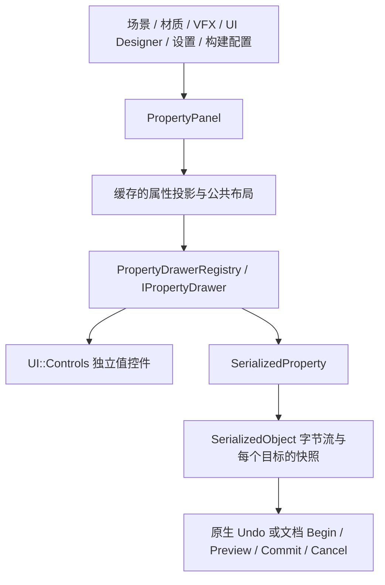

# 统一属性面板与独立控件

实现入口为 `Project/Editor/Properties/PropertyPanel.h`。原有 Inspector、脚本 `PropertyField` 和反射值编辑 API 保留，并共享同一绘制及序列化路径。

## 分层



`UI::Controls` 接收普通值和调用方提供的 ID、交互状态、只读及样式参数，不依赖编辑器、资产数据库或撤销服务。内置控件按类型独立实现；注册新的 Drawer 不需要修改面板的类型分支。

`InspectorPropertyEditor` 保留为兼容绘制内核，负责布局、游标解析和事务边界。内置类型的绘制实现位于 `BuiltinPropertyDrawers.cpp`，通过同一注册器接入。

## 使用入口

```cpp
Properties::PropertyPanel properties;

// 场景或已有规范化后端：面板不创建第二套数据模型。
Properties::PropertyPanelOptions options;
options.identity = documentId;
options.search = filter;
properties.Draw(serializedObject, options);

// 普通值及文档编辑副本。
properties.SetLifetime(document.Lifetime());
auto edit = properties.DrawValue("settings.speed", "Speed", speed);

// 文档宿主继续使用已有事务桥接；保存和应用由文档自己执行。
Inspector::ApplyReflectedEdit(host, edit, "Edit speed");
Inspector::FinishReflectedEdits(properties, host);
```

多选使用 `DrawValues`，ID 应包含业务选择集身份；面板还会叠加 ImGui 宿主范围与自身实例身份。同一选择集的数值变化不会重建属性投影。源值发生冲突时，旧暂存编辑被取消。

`ReflectedPropertyOptions` 支持提供默认值、继承值及宿主拥有的恢复继承动作。宿主回调仅在本次绘制中使用，呈现缓存和反射值后端不保留这些回调。材质的恢复继承动作调用 `MaterialEditingService::ClearParameter`，因此仍然移除稀疏覆盖。

## 增加控件

```cpp
class AngleDrawer final : public Properties::IPropertyDrawer
{
public:
    UI::Controls::ControlResult Draw(Properties::PropertyDrawerContext& context) override
    {
        float value = context.value.GetValue<float>();
        float minimum = -180.0f, maximum = 180.0f;
        UI::Controls::ScalarOptions options;
        options.minimum = &minimum;
        options.maximum = &maximum;
        options.slider = true;
        auto result = UI::Controls::Numeric(context.widgetId.c_str(), value, options);
        if (result.changed)
            context.value = value;
        return result;
    }
};

Properties::PropertyDrawerRegistration registration;
registration.scope = Properties::DrawerScope::ExplicitMetadata;
registration.identifier = "MyModule.Angle";
registration.metadataKey = "Angle";
auto registrationToken = Properties::PropertyDrawerRegistry::Get().Register(
    std::move(registration), std::make_shared<AngleDrawer>());
```

字段元数据设置 `customDrawer = "Angle"` 即可选用。需要临时 UI 状态的控件通过 `context.GetState<MyControlState>()` 获取当前属性的独立实例；状态应存放选中项、缩放和输入缓冲，不应保存目标对象指针。

模块必须保留注册令牌，并在卸载前释放。令牌注销会清理属性控件的扩展状态；在当前绘制调用内注销时，清理延迟到该调用退出。注册和注销在编辑器 UI 线程执行。

解析优先级为：字段及声明类型、显式元数据、精确类型、类型族、内置控件、只读兜底。旧字段注册允许空声明类型作为兼容通配，新注册要求明确声明类型。重复选择器或重复标识符报错。

## 编辑规则与高级控件

- `ControlResult` 汇报开始、活动、变化、结束和取消；复合控件在其子项或弹窗仍活动时不会结束手势。
- 向量、颜色、矩阵和包围体按分量更新。四元数按每个目标自身的欧拉角更新指定轴；撤销保留各目标自己的完整字节流快照。
- 数值控件通过右键或 `Ctrl+Enter` 打开算式输入；支持四则运算、常量和常用函数。整数运算保留 64 位精度，非法、溢出、非有限和非整数结果会被拒绝。
- 文本使用动态缓冲；源码属性支持多行及 Tab 输入。
- 曲线控件提供预览、通道、关键帧选择、增删、拖动、切线、权重、吸附和视图缩放。原生 AnimationCurve 与 VFX 多通道曲线通过适配器保留各自的资产表示。
- 渐变控件独立编辑颜色键和透明度键，支持 HDR、位置与插值模式。
- 混合曲线和渐变先通过“使用主值”、粘贴或重置明确统一，再编辑关键帧。
- 资源预览复用 Asset Browser 的异步服务及 GPU 池，按资源身份、版本、代次和宿主生命周期校验结果。
- 集合使用独立的 Unity 风格数组/List 控件，支持数量框、多选、键盘、拖拽、批量操作与引用拖放；固定缓冲区保留固定长度，可变行高按可见范围裁剪。详细行为及验收边界见 [UnityArrayAlignment.md](UnityArrayAlignment.md)。

## 验证入口

- `NullusPropertyControlsTests`：只链接 UI 与 GoogleTest，验证控件的依赖边界、精度、几何、预览失效、真实鼠标/键盘输入以及三个 DPI 的绘制。
- `NullusInspectorPropertyTests`：既有规范化序列化与 Inspector 回归，以及统一面板、扩展注册、注销清理、多选分量、矩阵和撤销测试。
- `NullusUIDesignerTests`、材质与 VFX 编辑器测试：验证文档事务和现有使用方。

这些自动化检查与实际 Editor 中的交互、GPU 预览及其他平台验收分开记录。

### 2026-10-25 验证记录

Windows Debug 的 `Editor` 构建通过。七组回归共 **424/424 通过，0 跳过**：

| 目标 | 通过用例 |
| --- | ---: |
| NullusPropertyControlsTests | 14 |
| NullusInspectorPropertyTests（含 NativeSerializedStream） | 103 |
| NullusUIDesignerTests | 82 |
| NullusMaterialEditorTests | 7 |
| NullusVfxAuthoringTests | 98 |
| NullusVfxEditorTests | 17 |
| NullusVfxEditorPanelTests | 103 |

覆盖实际鼠标拖动与文本输入、Esc 取消、UTF-8 容量限制、窄列颜色布局、64 位 Flags、弹窗关闭提交、选择回调延迟、模块注销清理、多目标快照撤销及原生序列化往返。

测试使用 PowerShell 包装器传递筛选表达式：

```powershell
& Tools/BuildCleanEnvironment.ps1 ctest --test-dir build -C Debug -j 1 --output-on-failure -R '^(NullusPropertyControlsTests|NullusInspectorPropertyTests|NullusUIDesignerTests|NullusMaterialEditorTests|NullusVfxAuthoringTests|NullusVfxEditorTests|NullusVfxEditorPanelTests)$'
```

实际 Editor 的手工交互、GPU 预览观感和跨平台验收尚未完成。自动化 DPI 绘制与输入测试不代替这些验收。


### 数组/List 的后续验证

Unity 风格数组/List 接入后，Editor Debug 再次构建通过，七组回归 **457/457 通过，0 跳过**。其中独立控件 29 个、Inspector/序列化 121 个，其余五组数量保持上述记录。数组行为、18 张 DPI/主题/拖动渲染图的位置，以及 Unity 实机对照限制见 [UnityArrayAlignment.md](UnityArrayAlignment.md)。
