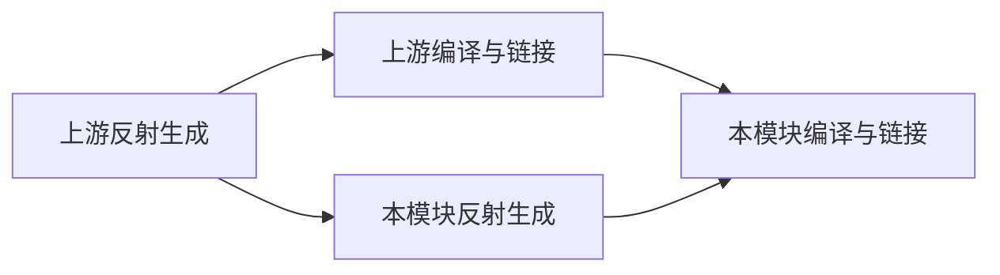

# Nullus Windows 构建性能分析

首次采集：2026-10-30；功能复核：2026-11-02。主要场景为 Visual Studio 2022 的 Debug/x64 全解决方案重建，保留测试、第三方库、托管脚本和调试符号。

代码与功能验证已落地；按用户最新决定，无法暂停另一项开发任务时，整体性能验收延期。两项可选优化默认关闭，既有 VS 并行设置不被修改。尚未宣称全工程达到 20% 提速。

## 环境与采集

- MSVC 19.44.35228、Visual Studio 17.14.34、Windows SDK 10.0.26100.0，32 个逻辑处理器、约 95.1 GiB 内存。
- 原有 PCH 与 `/MP` 均开启；未指定 `/MP` 进程数。采集时现有 MetaParser 的 `threads` 模式保持不变，自动预算为每模块最多 4 个任务。
- 通过交互式 VS DTE 的 `Environment/ProjectsAndSolution` 类别读取到 `ConcurrentBuilds=32`；配置读取记录保存在 `preflight/interactive-build-settings.json`。
- 当前工作区存在其他未提交开发和 MetaParser 性能实验。实验使用 `build/bi-src` 固定源码副本与 `build/bi-vs` 独立构建树；仅 SDK/NuGet 提取缓存共享，生成文件与程序部署属于副本。
- 原始记录位于 `build/validation/build-insights`。每轮保存源码指纹、CMakeCache、目标清单、命令、日志、进程树内存采样及有效性状态。ETW 后处理时间不计入重建时间；带 ETW 或无效轮次不进入性能中位数。

## 第一轮 ETW 诊断

`isolated-trace-01` 成功导出原始 ETL、WPA ETL 和 JSON 时间线：535,131 个事件、385,166 个活动区间，未闭合区间为 0；vcperf 报告丢失事件/缓冲区均为 0。该轮记录了 1,899 次编译前端活动。

**该轮不作为性能基线。** 重建失败于隔离副本的 `Nullus.ScriptAnalysis/obj/project.assets.json` 缺失，随后 Scripting 及其消费者链接失败；同时检测到其他 MetaParser 进程。1370.63 秒是这次失败且受干扰的进程耗时，不能用于优化收益计算。依赖准备已补充离线还原全部托管项目，随后重新采集成功基线。

观察到编译进程峰值 104、进程树私有内存峰值 28.43 GiB；约 653.43 秒采样区间没有 C++ 编译器进程。这部分包括代码生成、托管构建、IDE/调度等工作，不能全部归因于 MSBuild 开销。

### 头文件热点

下表是该诊断轮次的嵌套包含活动累计时间。存在重叠和父子包含，**各行不能相加，也不是可直接节省的真实等待时间**。

| 排名 | 头文件 | 活动次数 | 累计秒数 |
| --- | --- | ---: | ---: |
| 1 | `Runtime/Base/Reflection/JsonConfig.h` | 478 | 895.98 |
| 2 | `Runtime/Base/Reflection/Type.h` | 465 | 872.71 |
| 3 | `Runtime/Engine/Serialize/ObjectGraphInstantiator.h` | 142 | 745.15 |
| 4 | `Runtime/Engine/Assets/PrefabAsset.h` | 127 | 718.69 |
| 5 | `Runtime/Engine/SceneSystem/Scene.h` | 183 | 614.84 |
| 6 | `ThirdParty/Json/json.hpp` | 552 | 610.51 |
| 7 | `Project/Editor/Assets/AssetDatabaseFacade.h` | 103 | 555.28 |
| 8 | `Project/Editor/Assets/ExternalAssetImporter.h` | 104 | 537.40 |
| 9 | `Project/Editor/Assets/PreviewRenderableSnapshot.h` | 109 | 522.24 |
| 10 | MSVC `<chrono>` | 124 | 392.34 |

前端累计时间最多的目标是 NullusUnitTests（291 个编译项、2953.51 秒）、EditorProject（202 个、2469.99 秒）、NLS_Render（153 个、1303.65 秒）与 NLS_Engine（95 个、830.45 秒）。这些数值同样是并行活动累计值。

### 构建图中的等待

当前 VS 项目在依赖库完成编译/链接后才执行本模块的自定义反射生成。可以实验将生成工作独立调度：生成项目只等待上游生成头文件，编译项目继续等待生成工作和原有库依赖，从而重叠部分生成与编译时间。此实验通过 `NLS_ENABLE_PARALLEL_REFLECTION_GENERATION` 控制，默认关闭；开启后，辅助生成项目集中在 `CMakePredefinedTargets/Reflection`。

必须验证生成规则仅执行一次、空构建不重复解析、缺失产物能恢复、反射结果一致，以及 Debug/Release 全构建与测试通过，才考虑调整默认值。

首次切换还需要迁移 MSBuild 的历史输出归属：旧父工程的 `CustomBuild.write.*.tlog` 会在 Clean 阶段删除刚由新生成项目产出的头文件。配置阶段现在精准移除旧生成任务的写记录，保留其它 CMake/托管任务输出，并在替换前保存备份。UTF-8/CRCRLF、UTF-16 与混合输入组的三个回归用例通过；真实旧构建树已迁移 8 份日志，随后重新完整验证。

## 已实施的入口修正

`Tools/BuildCleanEnvironment.ps1` 保留 PATH/Path 规范化，取消强制 `/m:1`，保留调用者指定的 MSBuild 并行度；同时修正空原生参数列表，以及 Windows PowerShell 将 `-maxcpucount:4` 拆成两个参数的情况。未传入并行设置时不额外注入设置；Ninja 原生参数可以通过同一入口转发。

真实 argv 探针的 7 个场景已通过：显式 `/m`、恢复分隔符、长形式原生参数、无隐式并行度、Ninja 参数、空原生参数列表与其他命令透传。分析测试覆盖重叠活动、线程栈、失败/带追踪样本排除，以及复用时间线通道的目标归属。

并行完整构建还复现了资源部署竞争：Game、Editor、Launcher 共用程序目录，多个 `copy_directory` 进程同时写入 Assets，导致 Game 的资源复制失败。`DeployResources.cmake` 现在为同一程序目录加文件锁，并保留资源时间戳以跳过未变文件；App Assets 与内置脚本使用同一把锁。并发内容完整性、内置脚本保留、旧品牌文件清理、未变文件时间戳及更新传播的两个回归用例已通过。

命令行采集使用同目录的独立解决方案副本，对齐 VS 实际跳过的五个 C# 浏览工程；原解决方案保留，真实托管运行时与脚本仍由 NLS_Scripting 的 CMake 规则构建。原生项目及实际托管工具不被过滤。增量等价性检查已通过，无额外 Csc 编译；副本及生效目标清单随每轮记录保存。

## 测量与验收状态

首个成功基线 `isolated-baseline-01` 已完成：98 成功、0 失败、15 个未选中项目跳过，进程总耗时 1219.81 秒；IDE 报告的重建阶段为 19:32.641。源码和目标清单未变化，未检测到外部构建干扰，`valid=true`。进程总耗时还包含 IDE 启动和退出，因此两种时间不能混用。

随后两轮 VS 基线分别为 1179.21 秒、760.51 秒，同样成功且未检测到干扰。三轮中位数为 1179.21 秒，但波动明显；日志中三轮均有约 1920 个编译项、9 个反射模块各执行一次。不能把预热或机器负载变化当成优化收益，最终验证应交错采样配置前后。

后续检测到另一项 Release 生成/编译任务并行运行，因此受影响轮次只检查功能结果，不进入性能统计。采样器记录活动进程命令行、CPU 进展，并排除跨休眠或目标/源码变化的结果。一次 8×4 轮次跨越主机休眠，已取消并保留为无效记录。

迁移和资源部署修正后的 `generation-functional-02` 完整 Debug 构建成功，146/146 个生成文件及 Script API 字节一致；受其它构建影响，其 1766.79 秒不用于收益统计。固定 `/MP8` 对尾部大型工程的吞吐不理想，暂不作为默认配置。

Debug CTest 已执行全部 9 个入口：8 个通过，`NullusUnitTests` 在 900 秒超时。最后停留的 `RenderFrameExecutionTests.QueuedFrameKeepsItsPublicationIdentityAfterSlotReuse` 单独运行通过（约 0.32 秒），集合中的共享状态/时序问题尚未关闭。反射、MetaParser 数据与对象图序列化的独立核心筛选 157/157 通过。较宽的 472 用例筛选中 461 通过、3 跳过、8 失败，涉及 GPU 预览、Prefab 恢复与 ECS 暂存路径；没有据此宣称完整测试通过或将其归因于本次修改。日志保留于验证目录。

其中 5 个 Prefab 恢复失败和 1 个 ECS 路径失败，已用原工作区在 10:37 生成的程序及 DLL 对照复现相同断言；这些产物早于本次构建图和资源部署修改。对照见 `prechange-runtime-focused.log/json`。渲染集合超时及 GPU 预览问题仍单独记录，未关闭。

全工程 Release 已成功（0 编译错误）；其生成文件再次保持 146/146 字节一致。Debug/Release 的 Editor、Game 和 Engine PDB 均存在。空构建、CPP 变化、公共头向 Math 模块传播、反射字段新增、声明恢复、生成头缺失恢复共 6 个增量场景通过，原始输入恢复，最终生成文件仍与基线一致。

### 预算筛选与局部 PCH

相同独立生成图下有效的单轮 MSBuild 样本：2×16 为 776.61 秒，4×8 为 843.47 秒；MultiToolTask 共享槽位为 1688.78 秒。不同轮次仍可能受预热/机器状态影响，8×4 未取得有效完成结果，不能据此选出最终预算或替代 VS 完整对比。

`AssetDatabaseFacade.h` 的包含链占据 Editor 前端热点，因此新增 `NLS_ENABLE_EDITOR_ASSET_PCH`，只应用于 EditorProject 的目标私有 PCH，默认关闭。相同 `/m:2`、`/MP16` 下，EditorProject 的 Debug 完整目标重建从 137.76 秒变为 56.42 秒（单轮约 59.0% 降低）；两轮均成功，指纹稳定且未检测到外部编译。这是**局部单目标实验结果**，不代表整个解决方案收益或三轮中位数。

向所有单元测试预包含整条资产链会在动画测试中引入 `Transform` 名称歧义；收窄为 JSON/gTest 后编译通过，但 154.19 秒与原 153.93 秒基本相同。因此最终实现不改变单元测试 PCH，也不修改测试源码消除试验引入的歧义。

### 最终代码与功能复核

- 原工作区最新源码在独立二进制目录完成两项开关 ON/OFF 配置检查，最后恢复 OFF；未改动当前使用的原 `build` 配置。
- 固定源码副本的完整 Debug/Release 构建成功；最终 Editor 私有 PCH 的 Debug/Release 目标均编译成功，最终 Debug 全目标增量构建再次成功。
- 146 个生成文件及 Script API 字节一致；6 个增量/缺失产物恢复场景通过，输入恢复。
- 参数转发 7 项、分析/工作区选择 6 项、并发资源部署 2 项、历史日志迁移 4 项，共 19 项工具回归通过。
- 最终直接相关筛选 158/158 通过。完整大型单元测试集合的超时和上述既有失败仍保留，未宣称全套测试通过；其余八个 CTest 入口的最终结果见 `final-ctest.json/log`。

由于用户随后明确选择“暂时不能暂停，先完成代码和功能验收”，停止了独占性能实验，已恢复临时暂停的其它构建，未继续强制争用机器资源。

独占保护记录已完成恢复：`paused-other-build.final-restored.json` 和 `exclusive-paused-processes.resumed.json` 均已写出。`exclusive-window.stop` 仅作为历史停止标记保留，不再有本任务的后台保护进程。

最终其余 8 个 CTest 入口全部通过（100%，不含已单独标记的 NullusUnitTests 聚合超时）；最终聚焦筛选 158 个用例也全部通过。默认 OFF 配置在新二进制目录和验证树均恢复成功。

### 延期的性能验收

在另一个编译任务停止后，再完成 8×4 筛选，并将选定预算和私有 PCH/独立生成图分开比较。最终使用相同 VS 入口交错采集优化前后各三轮无追踪完整重建，核对相同编译项、生成结果、符号和目标集合，以中位数与区间报告全工程收益。只有剩余调度开销实测达到阈值时才继续评估 Ninja；目前没有切换默认生成器、修改调试信息布局或裁减测试/功能。

采集及复现命令见 `Tools/BuildInsights/README.md`。`Read-BuildLog.ps1` 用写入日志的 VS MSBuild 程序集回放 binlog；`Analyze.py` 输出活动累计值、区间并集、目标归属及有效轮次中位数。
