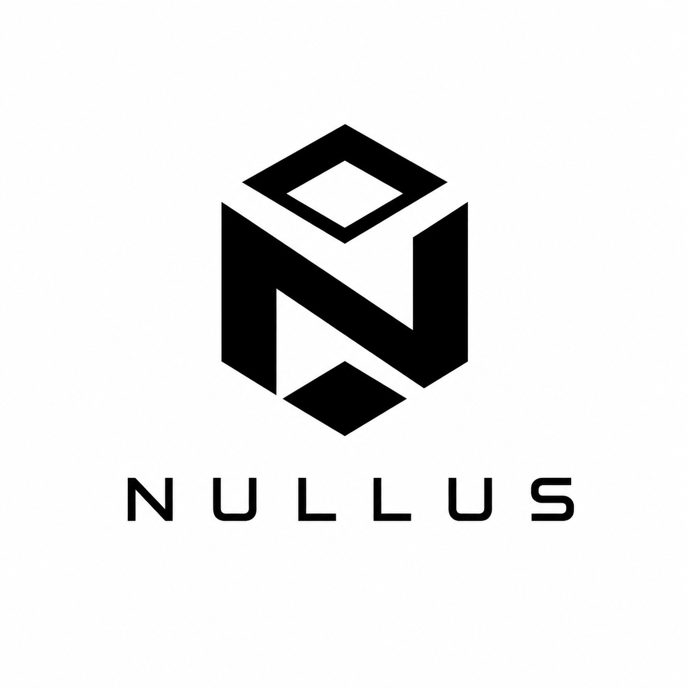
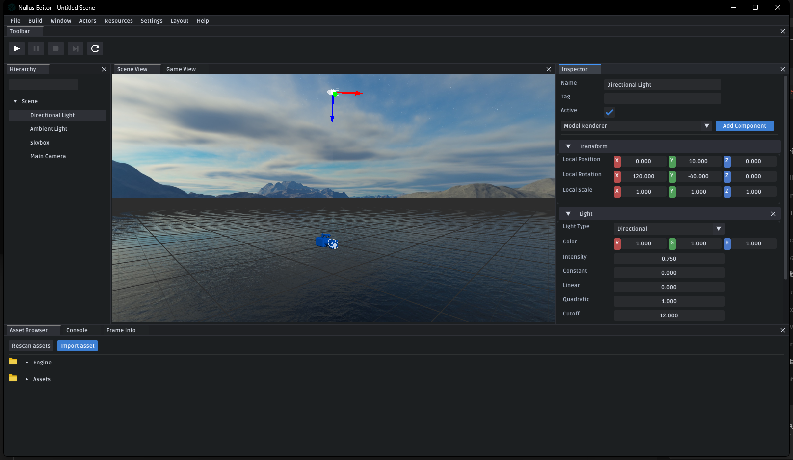
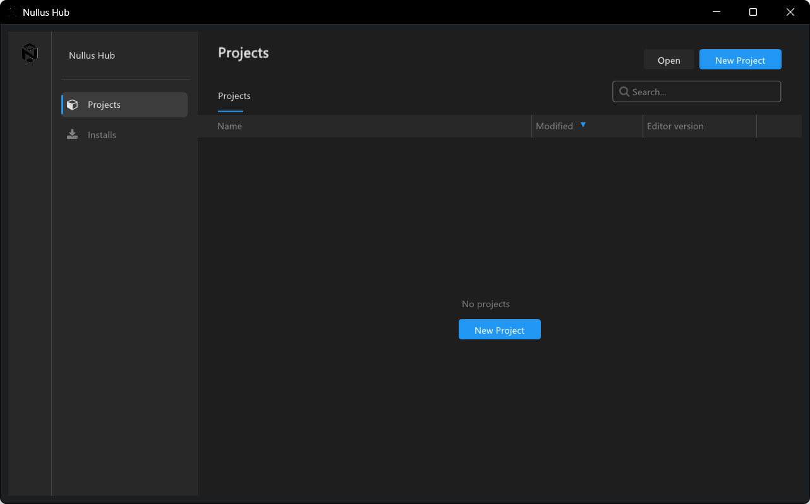

# Nullus

<p align="center">
    
</p>

<p align="center">
    <strong>面向实时 3D 创作的 C++20 原生引擎</strong><br>
    从场景、资产和脚本，到 Editor、运行时与多后端渲染，使用同一条引擎主链路。
</p>

<p align="center">
    <a href="./README.md">中文</a> | <a href="./README.en.md">English</a>
</p>




## 为实时创作而生

Nullus 是一个持续演进的 C++ 3D 引擎。它将原生运行时、项目启动器、可视化 Editor、资产导入、场景序列化与游戏脚本放在同一套工作流中：既能直接在 Editor 中组织和运行场景，也保留了面向引擎研发的清晰模块边界与显式 RHI 架构。

### 现代且可演进的渲染主线

- **显式多后端 RHI**：Windows 的 DX12 与 Linux/WSL 的 Vulkan 1.1 是当前已验证的运行时主线；macOS 的 Metal 原生后端和构建目标也已纳入工程。
- **FrameGraph 驱动的场景渲染**：前向与延迟路径覆盖 GBuffer、clustered lighting、decal、skybox、透明物体和编辑器视图输出，资源依赖与状态转换由图管理。
- **统一 HLSL 工作流**：HLSL 是唯一维护的着色器源，DXIL、SPIR-V 与反射数据由编译产物生成，材质、Pass 和 Object 的绑定空间保持一致。
- **面向大场景的渲染优化**：已有可见性收集、绘制命令缓存、实例化合批、静态网格 LOD 构建与运行时选择；DX12 上的 HZB 遮挡剔除按设备能力保守启用。

### 对齐 UE 的多线程渲染主线

渲染采用命令式线程模型：Game Thread 只产生命令，Render Thread 消费命令并构建帧，RHI 工作按队列类型收口到单一提交入口。

- **命名的执行通道**：`RenderingThreadSystem` 管理 Game、Render 与 RHI 三条逻辑通道，并提供 `IsInGameThread` / `IsInRenderingThread` / `IsInRhiThread` 判定；Render 与 RHI 启动后附着到 TaskGraph，Tasks 模式下 RHI 通道由 TLS 执行上下文表示，不依赖固定 OS 线程。
- **Render Command 管线**：主管是严格 FIFO 的串行队列，场景代理增删改、帧渲染、resize 与资源释放统一通过 `EnqueueRenderCommand` 进入 Render Thread；异步管只承载独立资源准备，并以依赖事件在消费前显式合并。
- **RHI 三管执行器**：Dispatch 由 Render Thread 串行接收并分配全局 submission sequence；Translate 在 worker 上并行生成原生命令缓冲；Submit 严格按序执行队列提交、跨队列信号量、readback 与 Present。
- **可切换的 RHI 通道模式**：项目设置 `rhi_thread_mode` 提供 `none`、`dedicated_thread` 与 `tasks` 三种模式。DX12 与 Vulkan 默认 `tasks`，Metal 在完成线程归属与并发提交验证前保持 `dedicated_thread`；后端以 `supportsRhiTasksMode` 能力位声明支持，强制请求不支持的组合会给出明确原因并启动失败，不会静默回退。
- **帧资源与 GPU 围栏**：`FrameResourceRing` 的槽位只回答“GPU 是否仍在使用这批资源”，复用时机由 GPU fence 决定；CPU 帧延迟由 `FrameLatencyController` 与 `RenderCommandFence` 的 Render / Rhi / Swapchain 三级同步深度共同管理。
- **增量场景与单帧载荷**：Game Thread 不再每帧复制完整场景。`SceneRenderStore` 是 Render Thread 独占的持久场景数据，由 Game Thread 以命令增量更新；每帧只传递 `RenderFramePacket`（相机、View、输出目标与单帧参数）。
- **TaskGraph 调度**：每个 worker 维护按优先级划分的本地队列，外部提交进入共享注入队列，空闲 worker 执行 work stealing；`TaskCompletion::Wait()` 在 worker 上协助执行可运行任务以避免嵌套等待死锁，`RequestCancel` 沿依赖图传播并唤醒全部等待者。

### 可视化的材质与 ShaderLab 工作流

- **内置 StandardPBR 基线**：引擎自带 `StandardPBR` ShaderLab 资源；模型导入会将材质、纹理和子资源接入这一套 PBR 内容链路。
- **由着色器定义材质参数**：ShaderLab 属性支持 Float、Int、Range、Vector、Color 与 Texture2D / TextureCube。材质还可管理关键词集合和渲染队列覆盖，使参数、变体与渲染状态保持在同一资源对象中。
- **独立材质工作台**：Material Editor 编辑 `.mat`、ShaderLab 与 ShaderGraph，提供反射参数、节点图、球体预览和撤销。Working、Saved 与 Applied 分开管理；Save 写源文件，Apply to Scene 发布编译成功的结果，失败时保留场景中的有效材质。
- **资源化与安全重载**：材质作为可异步加载和预热的资源工件管理。ShaderLab 重载先校验请求的变体，成功后更新关联材质并使受影响的管线代次失效。

### 从源文件到可用资产

- **项目级 Asset Browser**：资源浏览、搜索、拖放、缩略图、预览、对象引用选择和资源目录贯穿 Editor 工作流。
- **模型与材质导入**：支持 glTF / FBX 场景和模型导入，生成网格、材质、纹理与子资源；静态网格可配置 LOD 导入、简化和打包。
- **PBR 内容管线**：标准 PBR 材质、纹理颜色空间处理、Mip 与压缩构建、材质资源和 ShaderLab 资产导入已经接入资产数据库。
- **Prefab 与场景资产**：可从场景对象创建 Prefab Variant，并通过反射式对象图序列化保存场景、对象关系和组件字段。

### 一套对象模型，两种脚本语言

- **C# 与 Lua 并行可用**：CoreCLR 与 Lua 后端通过同一套原生脚本 ABI 和 API 清单连接 `GameObject`、`Transform`、`Component`、`Camera`、`Light`、输入与时间系统。
- **熟悉的组件化生命周期**：`Awake`、`OnEnable`、`Start`、`Update`、`OnDisable` 和 `OnDestroy` 让脚本逻辑直接贴合场景对象。
- **迭代不离开 Editor**：保存 C# 脚本后由 Asset Watcher 增量构建，成功程序集会在帧边界热重载并保留字段；失败时继续运行上一份有效程序集。
- **面向调试的工具链**：可生成 VS Code / Visual Studio 配置，附加到正在运行的 Editor，支持 C# 断点和混合调试工作流。

### 让创作流程留在 Editor 内

- **项目启动器**：创建、打开和管理项目，统一进入对应 Editor。
- **可视化场景编辑**：Hierarchy、Scene View、Game View、Inspector、组件选择器、播放控制、变换 Gizmo 与命中代理选取组成日常编辑闭环。
- **资源即时可见**：模型、材质、贴图、Prefab 与脚本在 Asset Browser 中拥有分类、图标和异步预览能力。
- **材质调试在场景旁完成**：从资源选择、属性编辑到球体预览均在 Editor 内完成，不需要离开当前项目上下文。
- **性能可观察**：共享 Profiling facade 可接入 Tracy 或 Editor Timeline Profiler，渲染线程与 RHI 线程具备统一的 CPU/GPU 标记入口。

### 动画、粒子与成品构建

- **动画工作流**：Animation Workbench、Animator、GPU 蒙皮、状态机、BlendSpace 与 Notify 已接入制作和播放；Root Motion、IK、重定向和多角色性能预算仍需建设。
- **粒子工作流**：Particle Editor 通过模块栈制作 CPU/GPU 发射器，提供整系统预览、参数和曲线；场景支持 Sprite/Mesh 绘制与静态碰撞查询，完整功能覆盖和设备验收仍有边界。
- **Player 打包**：`NullusBuild` 按 Build Profile 收集依赖、Cook 内容、生成 `.npak` 并组装桌面 Player；安装器、自动更新和移动端交付尚未提供。

### 原生引擎基础设施

- `Scene / SceneManager / GameObject / Component` 组件化场景系统。
- MetaParser 代码生成反射，驱动类型注册、Inspector、对象序列化和脚本 API 清单。
- 原生 JobSystem 提供依赖、批处理、并行 for 和后台任务调度；渲染调度由带优先级、命名通道与 work stealing 的 TaskGraph 承担。
- Runtime 包含基础、场景、渲染、脚本与 UI 模块，并扩展了 `Animation`、`Physics`、`VFX`、`Cook`、`Build` 及配套编译器；Editor 与 Game 共享运行时主链路。

## 项目启动器

<p align="center">
    
</p>

从 Launcher 创建或打开项目后，即可进入上方展示的 Editor 工作区。

## 快速开始

### 环境要求

- Git
- CMake 3.18 及以上
- 支持 C++20 的编译器
- Python 3.8 及以上（依赖准备脚本）
- .NET SDK 8.0.408：CMake 会在缺失时下载安装到仓库内，不修改系统 `PATH`

### 获取代码并准备依赖

```bash
git clone https://github.com/NullusEngine/Nullus.git
cd Nullus
git submodule update --init --recursive
```

在 Windows：

```powershell
.\SetupDependencies.bat
cmake -S . -B build -G "Visual Studio 17 2022" -A x64
cmake --build build --config Debug --target Editor
```

在 Linux：

```bash
./SetupDependencies.sh
./build_linux.sh debug
```

在 macOS：

```bash
./SetupDependencies.sh
./build_macos.sh debug
```

构建完成后运行 `Editor` 开始创建项目和场景；`Game` 使用同一套运行时主链路运行项目内容。

若构建宿主环境报出 `MSB6001` 且提示 `Path` / `PATH` 重复，可使用仅影响构建子进程的环境清理入口：

```powershell
.\Tools\BuildCleanEnvironment.cmd cmake --build build --config Debug --target Editor
```

### 图形后端说明

- Windows 默认选择 `DX12`。
- Linux / WSL 默认选择 `Vulkan`；首次在 WSL 中可使用 `./build_wsl_vulkan.sh --install-deps` 安装脚本所需依赖，再运行 `./build_wsl_vulkan.sh`。
- macOS 构建默认选择 `Metal`。
- DX11 与 OpenGL 已被显式限制：启动时报告不受支持并正常退出，不应作为项目交付目标。

## 文档

完整手册保存在 `Docs/`，并以中英双语发布到 [Wiki](https://github.com/NullusEngine/Nullus/wiki)。Wiki 由 `Docs/` 生成，请不要直接编辑 Wiki 页面。

- [认识 Nullus](Docs/zh-CN/start/overview.md)
- [环境准备与构建](Docs/zh-CN/getting-started/build.md)
- [第一个项目](Docs/zh-CN/getting-started/first-project.md)
- [使用编辑器](Docs/zh-CN/editor/workspace.md)
- [场景与对象](Docs/zh-CN/scene/objects.md)
- [资产与内容管线](Docs/zh-CN/assets/pipeline.md)
- [渲染、材质与光照](Docs/zh-CN/rendering/overview.md)
- [大场景与资源管理](Docs/zh-CN/large-scenes/visibility-occlusion.md)
- [游戏逻辑与脚本](Docs/zh-CN/scripting/overview.md)
- [用户界面](Docs/zh-CN/ui/overview.md)
- [动画制作与验证](Docs/zh-CN/animation/workflow.md)
- [粒子制作工作流](Docs/zh-CN/audio-vfx/particles.md)
- [Player 打包与分发](Docs/zh-CN/platform-build/packaging.md)
- [平台、构建与发布](Docs/zh-CN/platform-build/platforms.md)
- [扩展与引擎架构](Docs/zh-CN/architecture/modules.md)
- [调试、性能与质量](Docs/zh-CN/quality/debugging.md)
- [参考手册](Docs/zh-CN/reference/layout-cli.md)
- [发展路线](Docs/zh-CN/roadmap/index.md)

## 跨平台与 CI

工程提供 Windows、Linux 与 macOS 的构建脚本，GitHub Actions 覆盖三平台构建，并继续执行反射和单元测试相关目标。具体构建选项与依赖准备方式见各平台脚本和上方文档。

## 参与贡献

欢迎通过 Issue、建议或 Pull Request 参与。提交前请阅读 [CONTRIBUTING.md](./CONTRIBUTING.md) 与 [CLA.md](./CLA.md)。

## License

Nullus Engine 使用自定义 Source-Available License。允许查看和修改源码、商业使用以及发布使用 Nullus Engine 制作的游戏；禁止分发引擎源码或使用本项目制作竞争引擎。详情见 [LICENSE](./LICENSE)。
